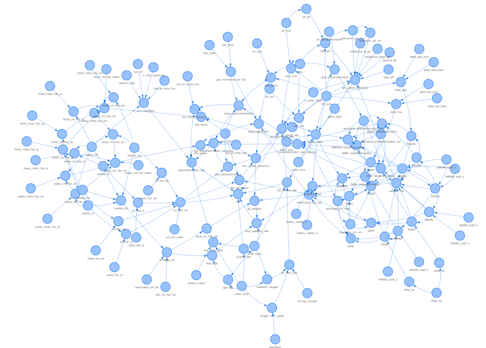

<!-- README.md is generated from README.Rmd. Please edit that file -->

```{r, include = FALSE}
knitr::opts_chunk$set(
  collapse = TRUE,
  comment = "#>",
  fig.path = "man/figures/README-"
)
```

# BIONICv3

<!-- badges: start -->

<!-- badges: end -->


```{=html}
BIONICv3 is an R package implementation of the “BIONIC” model by Armitage et al. (2013) which is a toxicokinetic model designed to predict bioconcentration factors (internal / external concentration ratios) for a wide range of chemical groups including ionisable compounds. The version of the model here is based explicitly on the VBA tool and BIONIC v3.0 User Manual and Technical Guidance Document (https://sites.google.com/view/bionic-v3/home) The package uses graphs to dynamically propagate default and calculated values throughout the model, allowing for complete flexibility for inputs and future model adaption.
```


## Installation

**This will change for published version**
```{=html}
To install and use the package locally, first clone the repository using (assumes access to DevOps):
```

```         
git clone https://SEAC-Projects@dev.azure.com/SEAC-Projects/Fish%20Exposure%20Calculator/_git/bionic_v3_package
```
```{=html}
Then install the package using the following commands (note, this requires devtools) 
```

```{r, eval=FALSE}
if (!require("devtools", quietly = TRUE))
    install.packages("devtools")

devtools::install(build_vignettes = TRUE)

# later likely replaced by devtools::install_github("INSERT PATH HERE")
```

```{=html}
It is recommended that the user installs the package with `build_vignettes = TRUE` as these contain helpful guidance and important information about the package and model.
<br>
You can then verify that the installation was successful by running
```

```{r }
library(BIONICv3)
```

## Example

```{=html}
For the generic use of the BIONICv3 default model, use the `run_bionic_v3()` function. A typical input for this function can be produced as such:
```

```{r example1}
example <-as.data.frame( list("biota_mass" = 0.01, 
                               "ion_type"="A", 
                               "pka"=3.9, 
                               "KOWN"=10^5.5, 
                               "reaction_rate"=0.5,
                               "water_temp"=12))
knitr::kable(example)
```

```{=html}
This example shows the minimum number of inputs for the model to be able to generate a prediction. However, it's possible to provide more complex data frames with additional columns of chosen values and the model will still be able to process this.
```

```{=html}
Here is then an example of how to run the model to generate BCF predictions. Note that the output is a list containing all parameters as they are calculated through the model in a list format. These can be converted to a data frame for further processing, e.g. keeping only the output values of interest.
```

```{r example2}
answer_list <- run_bionic_v3(example)
answer_df <- as.data.frame(answer_list)
bcf <- answer_df[,c("gill_uptake_rate",
                     "gill_elimination_rate",
                     "biotransformation_rate",
                     "fecal_egestion_rate",
                     "growth_rate",
                     "bcf")]
knitr::kable(bcf)
```

## BIONICv3 default graph

```{=html}
Here is the graph representation of the full BIONIC model, showing the scale and connectedness of the model's parameter space.
```


```{=html}
As it is difficult to view the large graph, we recommend viewing the "quick-start-guide" vignette as this has an interactive HTML render of the same graph. To view, run the following command and select [HTML].
```

```{r, eval=F, vignette, out.width="100%"}
utils::browseVignettes(package="BIONICv3")
```

</div>

</div>
