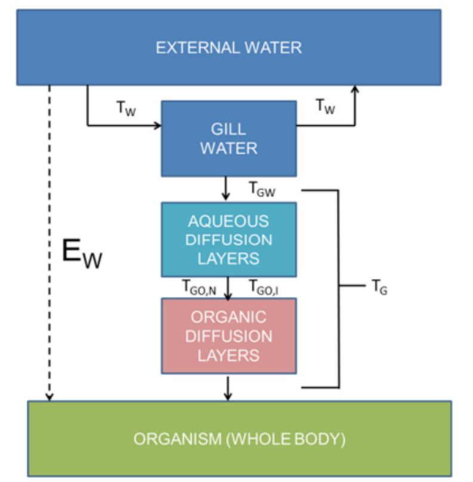

```{r, include = FALSE}
knitr::opts_chunk$set(
  collapse = TRUE,
  comment = "#>"
)
```

```{r setup}
#library(BIONICv3)
```

## BIONIC v3.0 introduction

::: {style="text-align: justify"}
The “BIONIC” model by Armitage et al. (2013) is a toxicokinetic model designed to predict bioconcentration factors (internal / external concentration ratios) for a wide range of chemical groups. The BIONIC v3.0 codified in this pacakge is based explicitly on the VBA tool and BIONIC v3.0 User Manual and Technical Guidance Document (<https://sites.google.com/view/bionic-v3/home>), however, it has not been published in the scientific literature. Therefore, it is important that we are explicit about all parts of the model and the model outputs. An important aspect of this R package is to provide a comprehensive overview of the inner workings of the model including sub models, how each sub model is populated with their description, derivation, parameters, and references for each parameter. Additionally, any theoretical scientific gaps have tried to be filled where applicable and all relevant information provided where possible.

BIONIC v3.0 improves on the BIONIC v1.0 model with key changes related to the calculation of the chemical uptake efficiency, the calculation of the biotransformation rate using quantitative *in vitro-to-in vivo* extrapolations (qIVIVE), inclusion of lysosome sequestration, splitting non-lipid organic matter (NLOM) into serum albunim and structural proteins that had not been included previously, and accounting for anionic phospholipids.

Importantly, the key changes aim to improve the models accuracy in terms of bioconcentration factor (BCF), and forward and reverse dosimetry predictions, in addition to, increasing the domain of applicability of the chemical space including:

-   Neutral organic chemicals
-   Monoprotic acidic ionisable organic chemicals (IOCs)
-   Monoprotic basic IOCs
-   Quaternary ammonium compounds (QACs)

### BIONIC v3.0 - Bioconcentration factor predictions

The main output of the BIONIC v3 model is the BCF. The BCF is defined as the ratio between the concentration of a chemical in an organism and the concentration of the chemical in the surrounding environment (Gobas & Morrison. 2000). The general theory originates from the Arnot & Gobas. (2004) study where it is assumed the rate of chemical uptake equals the rate of elimination resulting in a constant internal concentration over long exposure times. This is also referred to as the steady-state assumption. For the steady-state solution we can set $\frac{dM_B}{dt} = 0$, where $M_B$ is the mass of the chemical in the organism and the solution describes the net flux of the chemical absorbed or eliminated by the organism at any point in time ($t$), and the $\frac{M_B}{W_B} = C_B$ where $W_B$ is the weight of the organism at time ($t$), and $C_B$ is the internal concentration in the organism.

Arnot & Gobas. (2004) describes the prediction of internal concentration as,

$$C_B = \frac{k_1 \cdot C_W}{k_2 + k_E + k_G + k_M}\tag{1}$$

where $k_1$ is the clearance rate constant ($L/kg \cdot day$) that quantifies how quickly a chemical is taken up by an organism through its respiratory surfaces i.e. gills, $C_W$ is the concentration in the water column ($g/L$), $k_2$ is the elimination rate via respiratory areas ($days^{-1}$), $k_E$ is elimination via fecal egestion ($days^{-1}$), $k_G$ is the growth rate constant ($days^{-1}$), and $k_M$ is the biotransformation rate constant ($days^{-1}$).

Finally, to predict the steady-state BCF equation 1 can be re-arranged to equation 2,

$$\frac{C_B}{C_W} = \frac{k_1}{k_2 + k_E + k_G + k_M}\tag{2}$$

This general BCF model is still used in BIONIC v3 model with only slight alterations to the Arnot & Gobas. (2004) model as seen in equation 3,

$$BCF = \frac{C_B}{C_W} = V_w + \frac{kU}{kW + kB + kF + kG}\tag{3}$$

where $V_w$ is the volume fraction of water ($L/kg$), $kU$ is the gill uptake rate constant ($L/kg/d$), $kW$ is the gill elimination rate ($1/d$), $kB$ is the biotransformation rate ($1/d$), $kF$ is the fecal egestion rate constant ($1/d$), and $kG$ is the growth rate constant ($1/d$). The following is used to calculate the BCF in the package:
```{r eval=FALSE}
calc_bcf(gill_uptake_rate, gill_elimination_rate, growth_rate, fecal_egestion_rate,
         biotransformation_rate, vol_frac_list)
```

One of the main differences between equation 2 (Arnot & Gobas. 2004) and equation 3 (BIONIC v3) is the addition of the volume fraction of water term ($V_w$). Under steady-state conditions fish will have some concentration of chemical related to the external concentration in there aqueous phase (Mackay & Fraser. 2000). The importance of this addition is highlighted in equation 4 where when we are trying to calculate the internal concentration you need to to take into account the amount of chemical in the aqueous phase by multiplying the $V_w$ by the $C_W$.

$$C_B = V_w \cdot C_W + \frac{kU \cdot C_W}{kW + kB + kF + kG}\tag{4}$$

Each of the key parameters in equation 4 are calculated by sub-models, which will be discussed in detail in the following sections. The key parameters include,

-   Gill uptake rate constant ($kU - L/kg/d$)
-   Gill elimination rate ($kW - 1/d$)
-   Growth rate constant ($kG - 1/d$)
-   Biotransformation clearance rate ($kB - 1/d$)
-   Fecal egestion rate constant ($kF - 1/d$)

It is important to note that there is the option to account for mucus water partitioning but in this R package it is not applied to the model for now.
:::

## Gill uptake rate constant

::: {style="text-align: justify"}
The gill uptake rate constant for BIONICv3.0 is of the same form as Armitage et al. (2013) and Arnot et al. (2005) as seen in equation 5. The main difference between the BIONIC v3 and earlier versions is the way the chemical uptake efficiency is calculated which is explained further below. The form comes from the use of fugacity of the original equation as described in Appendix A.

$$kU = EW \cdot \frac{GV}{Mass}\tag{5}$$ Parameters

-   $kU (L/kg/d)$ - uptake rate constant via gill ventilation
-   $EW (unitless)$ - chemical uptake efficiency at the gill
-   $GV (L/d)$ - ventilation rate
-   $Mass (kg)$ - the mass of the fish (default value = 0.01, however, this value is usually inputted by the user)

The following is the function that represents the sub-model:
```{r eval=FALSE}
calc_gill_uptake_rate(biota_mass, gill_vent_rate, gill_uptake_efficiency)
```

### Gill ventilation rate

The gill ventilation rate is the same equation defined in BIONIC v1.0 but originates from Arnot et al. (2008) paper supplementary section. The form of the equation was also found in the Gobas & Mackay. (1987) study, which described the origin of the equation as from Norstrom et al. (1976). The gill ventilation is defined in equation 6,

$$GV =\frac{M}{DissO2 \cdot Eox}\tag{6}$$

Parameters

-   $GV (L/d)$ - ventilation rate
-   $M (mg/d)$ - the metabolic oxygen requirements of the fish (defined in equation 7)
-   $DissO2 (mg/L)$ - the oxygen concentration in the water (defined in equation 8)
-   $Eox (unitless)$ - the efficiency of oxygen transfer across the gills (default is 0.65, source is assumed to be Gobas & Mackay. (1987) as it was said in the Arnot et al. (2008)

The following is the function that represents the sub-model in the package:
```{r eval=FALSE}
calc_gill_vent_rate(oxygen_conc_water, metabolic_oxygen, eff_oxy_transfer=0.65)
```

The metabolic oxygen requirements mirrors the method Arnot used where the data from Fishbase for OXYREF(under routine metabolic test conditions) (Thomann. 1989) was used to create a linear regression between the wet weight of the fish and the temperature,

$$log_{10}M = 2.8 + 0.786 \cdot log_{10}Mass + 0.017 \cdot Water_T \tag{7}$$ Parameters

-   $M (mg/d)$ - the metabolic oxygen requirements of the fish
-   $Mass (kg)$ - the wet weight of the fish (The default value is 0.01, there are many references to this but normally this value is inputted by the user)
-   $Water_T (^\circ C)$ - the water temperature (default is 25 $^oC$)

The following is the function that represents the sub-model in the package:
```{r eval=FALSE}
calc_metabolic_oxygen(biota_mass, water_temp=25)
```


As previously stated the oxygen concentration in the water is sourced from Norstrom et al. (1976) and defined in equation 8 as follows,

$$DissO2 = S(14.45 - 0.413Water_T + 0.00556Water_T^2) \tag{8}$$ Parameters

-   $DissO2 (mg/L)$ - the oxygen concentration in the water

-   $S$ (%) - the percent saturation of the water (which is assumed 90% in VBA. Source is assumed in Arnot et al. (2004))

-   $Water_T$($^oC$) - the water temperature(default is $25^oC$)

Unfortunately, as we can see both equation 7 and 8 are dimensionally inconsistent. However, to find out the solution may require access to the original Norstrom et al. (1979) study, which at the time of writing we were unable to access.

The following is the function that represents the sub-model in the package:
```{r eval=FALSE}
calc_oxygen_conc_water(water_temp = 25, saturation = 0.9)
```

### Chemical uptake efficiency

The chemical uptake efficiency is updated from the BIONIC v1.0 or Armitage chemical uptake efficiency equation. This is due to very strongly dissociated chemicals resulting in the $\mu$ parameter being large and diffusion across the organic layers is hindered due to the low proportion of chemical in neutral form. Due to this the chemical uptake efficiency would be driven primarily by the value of $\beta$, which means it would not work properly for chemicals that are heavily dissociated.

In BIONIC v3.0 they try to improve on the uptake equation by explicitly treat the transport of the charged series across organic layers as explained in the technical guidance document, where they describe this derivation as a combination of two-film theory and developed fugacity-based models. In the next section we provide our reasoning of how the chemical uptake efficiency is derived from figure 1.

In figure 1 we see a representation of the revised fill uptake model in BIONIC v3.0 from the technical guidance document. The chemical uptake efficiency is defined as the efficiency the chemical is extracted from the water being taken up. This can be seen from the diagram, which is the ratio of the transport to the organism to the total transport(meaning the sum of the transport to the organism and back to the external water) resulting in equation 9.

$$EW = \frac{T_G}{T_G+T_W} \tag{9}$$

Now the $\beta$ is added to represent potential for passive uptake of the chemical in any form via paracellular routes which is revised to equation 10,

$$EW = (1+\frac{T_W}{T_G})^{-1} +\beta \tag{10}$$

As we can see in figure 1 that $T_{GO, N}$ and $T_{GO, I}$ are in parallel and that part is in series with $T_{GW}$. If we think back to high school physics and think about resistance in parallel and in series we would think of resistance in parallel to be the sum of reciprocal resistances and the resistance of a series as the sum of resistances, well it is flipped in this situation, which we believe is related to the 2-film theory. This theory implies that each film offers resistance to mass transfer, and the overall transfer rate depends on the combined resistance of both films. Therefore, for $T_{GO, N}$ and $T_{GO, I}$, which represent the transport term for the neutral or charged form of the chemical diffusing across organic layers in the gills, are multiplied by the fraction of that chemical being neutral/charged form, which later is then summed. After that for $T_{GW}$ being the diffusion through aqueous layers we do a sum of reciprocals to get the following equation,

$$\frac{1}{T_G} = (\frac{1}{T_{GW}}+ \frac{1}{T_{GO,N}FN_{gill} +T_{GO,I}FI_{gill}}) \tag{11}$$

As it says in the technical document for the aqueous phase there was no split between charged and neutral as they are assumed to be equal

Which give us the following equation for the chemical uptake efficiency

$$EW = \left[1+T_w\left(\frac{1}{T_{GW}}+ \frac{1}{T_{GO,N}FN_{gill}+T_{GO,I}FI_{gill}}\right)\right]^{-1} +\beta \tag{12}$$

Parameters

-   $EW$(unitless) - chemical uptake efficiency at the gill

-   $T_w$($(L\circ kg)/d$) - the transport term for the neutral and charged form of the IOC passing through the gill structure during ventilation.

-   $T_{GW}$($(L\circ kg)/d$) - the transport term for the neutral and charged form of the IOC diffusing across the aqueous layers at and in the gill membranes

-   $T_{GO,N}$($(L\circ kg)/d$) - the transport term for the neutral form of the chemical diffusing across organic layers in the gills membranes

-   $T_{GO,I}$($(L\circ kg)/d$) - the transport term for the charged form of the chemical diffusing across organic layers in the gills

-   $FN_{gill}$(unitless) - fraction of the chemical in neutral form at gill pH. Calculated using the gill pH in equation 69 where $\beta$ is gill

-   $FI_{gill}$(unitless) - fraction of the chemical in charged form at gill pH. Calculated using the gill pH in equation 69 where $\beta$ is gill

-   $\beta$(unitless) - the potential for passive uptake of the chemical in any form via paracellular routes(default is 0.0001 first described in Armitage et al. (2013) and in SI they look how it changes in Beta impact average prediction error)

```{r chem_uptake, fig.cap=" Figure 1. Chemical uptake figure", out.width="80%"}

```

#### Transport term equations

The following equations (13-16) define the transport terms,

$$T_w = GV * Mass * Z_{W,gill} \tag{13}$$ $$T_{GW} = G_{GW} * Z_{W,gill} \tag{14}$$ $$T_{GO,N} = G_{GO,N} Z_{O,N} \tag{15}$$ $$T_{GO,I} = \frac{G_{GO,N}}{\gamma} Z_{O,I} \tag{16}$$

Parameters:

-   $GV (L/d)$ - the gill ventilation rate as stated in equation 6

-   $G_{GW} (L/d)$ - the volumetric flow rate characterizing the transport of the neutral and charged form in aqueous diffusion layers

-   $G_{GO,N} (L/d)$ - the volumetric flow rate characterizing the transport of the neutral form in organic diffusion layers

-   $Mass (kg)$ - the wet weight of the fish

-   $Z_{W,gill}$ (unitless) - the total sorption (storage) capacity of the aqueous phase for the neutral and charged forms of the chemical

-   $Z_{O,N}$ (unitless) - the sorption capacity of the organic layers in the gill membrane for the neutral form of the chemical

-   $Z_{O,I}$ (unitless) - the sorption capacity of the organic (lipid) layers in the gill membrane for the charged form of the chemical

-   $\gamma$ (unitless) - he extent to which the diffusivity of the charged form of the chemical in organic phases is reduced compared to the neutral form of the chemical (default for acidic IOC's 10000 and for basic IOC's 300000)

The flow rates are defined in the following equations,

$$G_{GW} = \frac{GVMass}{R_w -1} \tag{17}$$

$$G_{GO,N} = \frac{GVMass}{R_L} \tag{18}$$

Parameters:

-   $G_{GW}$($(L\circ kg)/d$) - the volumetric flow rate characterizing the transport of the neutral and charged form in aqueous diffusion layers

-   $G_{GO,N}$($(L\circ kg)/d$) - the volumetric flow rate characterizing the transport of the neutral form in organic diffusion layers

-   $GV (L/d)$ - the gill ventilation rate as stated in equation 6.

-   $Mass$(kg) - the mass of the fish(The default value is 0.01, there are many refrences to this but normally this value is inputed by the user)

-   $R_w, R_l$(unitless) - the relative resistances of chemical transport (default is 1.85, 155) through aqueous and organic (lipid) diffusion layers at and within the gills respectively

#### Sorption capacity equations

The soprtion capacity equations depend on if the chemical is a Quaternary ammonium compound (QACs) or not. The following equations are sorption capacity equations are for non-QACs,

$$Z_{W,gill} = Z_{W, N}(1+RATIO_{gill}) \tag{18}$$ $$Z_{O,N} = KMWN * Z_{W,N} \tag{19}$$ $$Z_{O,I} = KMWI * Z_{W,Igill} \tag{20}$$ $$Z_{W,Igill} = Z_{W,N}RATIO_{gill} \tag{21}$$

Parameters:

-   $Z_{W,gill}$(unitless)- the total sorption (storage) capacity of the aqueous phase for the neutral and charged forms of the chemical

-   $Z_{O,N}$(unitless) - the sorption capacity of the organic layers in the gill membrane for the neutral form of the chemical

-   $Z_{O,I}$(unitless) - the sorption capacity of the organic (lipid) layers in the gill membrane for the charged form of the chemical

-   $Z_{W,N}$(unitless) - Z-value for chemical in water(default is 1 from the aquivalence approach in Chapter 2.7.5 (Parnis & Mackay. 2020))

-   $RATIO_{gill}$(unitless) - the ratio charged to neutral form at gill pH, equation 70}

-   $KMWN$(unitless) - the membrane-water partition coefficient for the neutral form, equation 58}

-   $KMWI$(unitless) - the membrane-water partition coefficient for the charged form, equation 58}

-   $Z_{W,Igill}$(unitless) - the z value of the charged form

Alternatively, for QACs,

$$Z_{w,gill} = Z_{W, N}, Z_{O,N} = 0 \tag{22}$$

### Simplified chemical uptake effieicny

If we expand the transport terms then the original equations changes to,

$$EW = \left[1+GV \cdot Mass \cdot Z_{w,gill} \\ \left(\frac{1}{G_{GW} \cdot Z_{w,gill}} + \frac{1}{G_{GO,N} Z_{O,N}FN_{gill}+\frac{G_{GO,N}}{\gamma} Z_{O,I}FI_{gill}}\right)\right]^{-1} +\beta \tag{23}$$

Then expanding the flow rate equations we get,

$$EW = \left[1+GV \cdot Mass \cdot Z_{w,gill} \\ \left (\frac{1}{\frac{GV Mass}{R_w -1} \cdot Z_{w,gill}}+ \frac{1}{\frac{GV Mass}{R_L} Z_{O,N}FN_{gill}+\frac{\frac{GV Mass}{R_L}}{\gamma} Z_{O,I}FI_{gill}}\right)\right]^{-1} +\beta \tag{24}$$

From equation 24 we see that the gill ventilation rate and the mass of the fish cancel out giving equation 25,

$$EW = \left[1+ Z_{w,gill}\left(\frac{1}{\frac{Z_{w,gill}}{R_w -1}}+ \frac{1}{\frac{Z_{O,N}}{R_L} FN_{gill}+\frac{Z_{O,I}FI_{gill}}{R_L\gamma}} \right)\right]^{-1} +\beta \tag{25}$$

Equation 25 can be expanded to get the final equation,

$$EW = \left[R_w + \frac{Z_{w,gill}}{\frac{Z_{O,N}}{R_L} FN_{gill}+\frac{Z_{O,I}FI_{gill}}{R_L\gamma}}\right]^{-1} +\beta \tag{26}$$ Parameters

-   $EW$(unitless) - chemical uptake efficiency at the gill

-   $R_w, R_l$(unitless) - the relative resistances of chemical transport (default is 1.85, 155) through aqueous and organic (lipid) diffusion layers at and within the gills respectively

-   $Z_{W,gill}$(unitless)- the total sorption (storage) capacity of the aqueous phase for the neutral and charged forms of the chemical

-   $Z_{O,N}$(unitless) - the sorption capacity of the organic layers in the gill membrane for the neutral form of the chemical

-   $Z_{O,I}$(unitless) - the sorption capacity of the organic (lipid) layers in the gill membrane for the charged form of the chemical

-   $FN_{gill}$(unitless) - fraction of the chemical in neutral form at gill pH. Calculated using the gill pH in equation 69 where $\beta$ is gill

-   $FI_{gill}$(unitless) - fraction of the chemical in charged form at gill pH. Calculated using the gill pH in equation 69 where $\beta$ is gill

-   $\gamma$(unitless) - he extent to which the diffusivity of the charged form of the chemical in organic phases is reduced compared to the neutral form of the chemical (default for acidic IOC's 10000 and for basic IOC's 300000)

-   $\beta$(unitless) - the potential for passive uptake of the chemical in any form via paracellular routes(default is 0.0001 first described in Armitage et al. (2013) and in SI they look how it changes in Beta impact average)

The following is the function that represents the sub-model in the package:
```{r eval=FALSE}
calc_gill_uptake_efficiency(partition_list, ratio_gill, ion_type, 
                            speciation_gill_neut, speciation_gill_ion, 
                            resistance_at_gill = 1.85, resistance_within_gill = 155,
                            z_water_value = 1, gamma_eff = NA, beta_eff = 0.0001)
```
:::

## Gill elimination rate

::: {style="text-align: justify"}
The format of the gill elimination rate for BIONIC v3.0 is similar to the one proposed in BIONIC v1.0, where the change is the calculation of the fish-water distribution ratio when accounting for lysosomal sequestration and the splitting of the non-lipid organic matter phase into serum albumin and structural protein components.

For the starting equation it is derived from the fish-water distribution ratio and to find the gill elimination rate we can use the uptake gill rate from the previous section and the calculation of the fish-water distribution ratio. To calculate the Fish-water distribution ratio, we can split it into two key parts: - calculation of the internal fish-water distribution ratio($D_{FW, L}$) - calculation that tries to capture the ion trapping effect in the model($\frac{Z_{W,bio}}{Z_{W,bulk}}$).

Ion trapping is the phenomenon describing the accumulation of a higher concentration of a molecule across the membrane due to difference of pH across the membrane (Pautu et al. 2017). This is resolved by the model using the Henderson-Hasselbach equations to describe the ratio between internal and external pH values.

$$kW = \frac{kU}{DFW_{I}} \tag{27}$$

$$DFW_{I} = \frac{Z_{F,bio}}{Z_{W,bulk}} \tag{28}$$

$$Z_{F,bio} = DFW_{Lys,kW} Z_{W,bio} \tag{29}$$

Parameters

-   $kW$(1/days) - The gill elimination/clearance rate

-   $kU$ (L/(kg$\circ$days)) - rate constant of uptake via gill ventilation

-   $DFW_{I}$(?) - Fish-water distribution ratio (external)

-   $Z_{F,bio}$(?) - Z value for fish

-   $Z_{W,bulk}$(unitless) Total Z-value in bulk (equation 32)

-   $Z_{W,bio}$(unitless) Total Z-value in fish (equation 31)

-   $DFW_{Lys,kW}$($L/kg$) - Fish-water distribution ratio(internal), recalculated to account for lysosomal sequestration

The following is the function that represents the sub-model in the package:
```{r eval=FALSE}
calc_gill_elimination_rate(gill_uptake_rate, dfw_uptake_lysosome, ratio_bio, 
                           ratio_bulk, ion_type, z_water_value = 1)
```

To get the fish water distirbution ratio, accounting for lysosomal sequestration, we use equation 75 using the calculated $DFW_{kW}$, $DMW$ and $DMWAN$ from below.

To calculate $DFW_{kW}$ we can start by comparing to the BIONIC v1.0 equation where there are two distinct changes, which include the splitting of the non-lipid organic matter into serum albumin and structural protein components and the use of anionic phospholipids for the membrane lipids. The explanation of the derivation can be found in Appendix B, where the only difference is the anionic phospholipids split. Note if $AnioncF$ is 0 them we just back the original $V_{pl}*DMW$ value.

$$\begin{gathered} DFW_{kW} = V_{sl}DSW + (1- AnionicF)V_{pl} \cdot DMW + AnionicF \cdot V_{pl} \cdot \\ DMWAN\ +V_{SerumAlb} \cdot DSAW+ V_{StructProtein}DPW +V_w \end{gathered} \tag{30}$$

Parameters

-   $DFW_{kW}$($L/kg$) - Fish-water distribution ratio(internal), modified to handle soprtion to anionic phospholipids

-   $V_{sl}$($L/kg$) - Fish volume fraction for storage lipids. Equation 73.

-   $V_{pl}$($L/kg$) - Fish volume fraction for membrane lipids. Equation 73.

-   $V_{SerumAlb}$($L/kg$) - Fish volume fraction for serum albumin. Equation 73.

-   $V_{StructProtein}$($L/kg$) - Fish volume fraction for structural protein. Equation 73.

-   $V_{w}$($L/kg$) - Fish volume fraction for water. Equation 73.

-   $DSW$(unitless) - Storage-lipid water distribution ratio. Equation 67 with $\alpha =SW$ and $\beta$ being the bio

-   $DMW$(unitless) - Membrane-water distribution ratio. Equation 67 with $\alpha =MW$ and $\beta$ being the bio

-   $DMWAN$(unitless) - Membrane-water distribution ratio to handle sorption to anionic phospholipids. Equation 68.

-   $DSAW$(unitless) - Serum albumin-water distribution ratio. Equation 67 with $\alpha =SAW$ and $\beta$ being the bio

-   $DPW$(unitless) - Structural protein-water distribution ratio. Equation 67 with $\alpha =PW$ and $\beta$ being the bio

-   $AnionicF$(unitless) - Fraction of membrane lipid that is anionic phospholipid. Default is 0.175, referenced in Schmitt. (2008)

The following is the function that represents the sub-model in the package:
```{r eval=FALSE}
calc_dfw(vol_frac_list, distribution_ratio_list, anionic_frac = 0.175)
```

Unless the chemical is "Q"(which would mean $Z_{W,bio}=Z_{W,N}$) the following equation is used,

$$Z_{W,bio} = Z_{W,N}(1+RATIO_{bio}) \tag{31}$$

Parameters

-   $Z_{W,bio}$(unitless) Total Z-value in fish

-   $Z_{W,N}$(unitless) Z-value for chemical in water. (default is 1 from the aquivalence approach (Chapter 2.7.5) (Parnis & Mackay. 2020))

-   $RATIO_{bio}$(unitless) - speciation at biological pH. Equation 70.

Unless the chemical is "Q"(which would mean $Z_{W,bulk}=Z_{W,N}$) the following equation is used:

$$Z_{W, bulk} = Z_{W,N}(1+RATIO_{bulk}) \tag{32}$$

Parameters

-   $Z_{W,bulk}$(unitless) Total Z-value in bulk

-   $Z_{W,N}$(unitless) Z-value for chemical in water. (default is 1 from the aquivalence approach (Chapter 2.7.5) (Parnis & Mackay. 2020))

-   $RATIO_{bio}$(unitless) - speciation at Bulk pH. Equation 70.
:::

## Growth rate constant

::: {style="text-align: justify"}
The growth rate constant is the same as the one in BIONIC V1.0 equation. There still needs to be extensive research undertaken into the origin of the growth rate constant.

$$kG = 0.00586\cdot(1.113^{Water_T-20})\cdot (1000*Mass)^{-0.2} \tag{33}$$

Parameters

$kG$(1/d) - growth rate constant

$Water_T$ - the water temperature(default is $25^oC$)

$Mass$(kg) - the mass of the fish(The default value is 0.01, there are many references to this but normally this value is input by the user)

The following is the function that represents the sub-model in the package:
```{r eval=FALSE}
calc_growth_rate(biota_mass, water_temp = 25)
```
:::

## *In vitro* to *in vivo* extrapolation (IVIVE)

::: {style="text-align: justify"}
The BIONIC v3.0 model includes an automated workflow that can estimate whole body biotransformation rate constants from liver S9 *in vitro* biotransformation rate data from fish using developed methods by Nichols et al. (2006) and Nichols et al. (2013).

We start with the main IVIVE equations of clearance and biotransformation rate calculations. Afterwards we look at the how to calculate the parameters for these main equations including the assay composition, blood composition and sorption capacity of the phases.

### Clearance and biotransformation rate calculations

These calculations show how the different clearance's can be calculated with the final equation showing how the biotransformation rate is calculated. The derivations of these equations can be found in Appendix C.

The first equation calculates the intrinsic *in vitro* clearance(derivation in Appendix C - intrinsic *in vitro* clearance) with the rate reaction(for more info on the rate reaction go to Appendix C - Reaction rate).

$$\begin{aligned} CLint_{invitro} = \frac{RateC}{AssayS9} \end{aligned} \tag{34}$$ Next the intrinsic *in vivo* clearance is calculated with its derivation in Appendix C - Intrinsic *in vivo* clearance,

$$\begin{aligned}CLint_{invivo} = 24 * CLint_{invitro} * LiverS9 * LiverBWF \end{aligned} \tag{35}$$ The blood flow to the liver ($QH_{LBW}$) is calculated as follows, with more information on it in Appendix C - Blood flow rate to liver,

$$\begin{aligned} QH_{LBW} = QH_{LiverF} * 24 * \left( (0.23 \times Water_{T}) - 0.78 \right) * \left( \frac{Mass * 1000}{500} \right)^{-0.1} \end{aligned} \tag{36}$$ The hepatic blood clearance ($CL_{H}$) is then calculated as follows, with its long derivation in Appendix C - Hepatic clearance,

$$\begin{aligned} CL_{H} = \frac{QH_{LBW} * CLint_{invivo} * \frac{DassayW}{DbloodW}}{QH_{LBW} + CLint_{invivo} * \frac{DassayW}{DbloodW}} \end{aligned} \tag{37}$$

Finally, to calculate an estimate for the whole body biotransformation rate constant ($kB$), where its derivation is explained in the Nichols et al. (2006) study.

$$\begin{aligned} kB = \frac{CL_{H}}{\frac{DFW_{ivive,Lys}}{DbloodW}} \end{aligned} \tag{38}$$

Parameters

-   $CLint_{invitro}$($ml assay/mg S9/h$) - Intrinsic in vitro clearance rate

-   $RateC$($h^{-1}$) - Reaction rate (Found in Donor, fish, in vitro rate data in "IVIVE S9 - BCF" sheet)

-   AssayS9($mg / ml assay$) - concentration of S9 which is defaulted as 2

-   $LiverS9$($mg~S9/g~liver$) - S9 content of liver tissue (IVIVE input in "IVIVE S9 - BCF" sheet). Default value is 163 with more information in Appendix C - Intrinsic *in vivo* clearance

-   $LiverBWF$($unitless$) - Liver body weight fraction with default of 0.015. More information of the default in Appendix C - Intrinsic *in vivo* clearance

-   $QH_{LBW}$(L/kg/d) - Blood flow to liver

-   $QH_{LiverF}$ - Cardiac output fraction to liver. Default value is 0.259, with more info in Appendix C - Blood flow rate to liver

-   $Water_{T}$($celsius$) - Water temperature (Located in "Test system" sheet and is always 12 degrees)

-   $Mass$($kg$) - Mass of fish (Located in "Biota" sheet and has a value of 0.01 kg)

-   $CL_{H}$($L / kg / d$) - Hepatic blood clearance

-   $DassayW$($unitless$) - Assay-water distribution ratio

-   $DbloodW$($L/L$) - Blood-water distribution ratio

-   $kB$($1/d$) - whole body biotransformation rate

-   $DFW_{ivive,Lys}$($L/kg$) - Fish-water distribution ratio (IVIVE), adjusted for lysosome sequestration

The equations are represented by the following functions in the package:
```{r eval=FALSE}
vitro_to_vivo_clearance(reaction_rate = NA, assay_s9 = 2, liver_s9 = 163,
                        liver_to_body_frac = 0.015, in_vitro_clearance = NA))
calc_liver_blood_flow(biota_mass, water_temp = 25, caridac_output = 0.259)
calc_biotransformation_rate(liver_blood_flow, in_vivo_clearance, dfw_assay,
                            dfw_blood_lysosome, dfw_biotransformation_lysosome)
```

### Assay composition

Firstly, the fraction of each biological macromolecule (storage lipids, membrane lipids, serum albunim, and structural proteins) in the assay medium is divided by the corresponding density to calculate the volume fraction of each macromolecule in the assay medium.

Parameters

-   $V_{slA}$(?) - Volume of storage lipids in assay medium calculated using equation 73

-   $V_{plA}$(?) - Volume of membrane lipid content in assay medium calculated using equation 73

-   $V_{Serum AlbA}$(?) - Volume of serum albumin content in assay medium calculated using equation 73

-   $V_{Struct ProteinA}$(?) - Volume of structural protein in assay medium calculated using equation 73

-   $V_{slA,adj}$(?) - Volume of storage lipids in assay medium adjusted due to $AssayS9$

-   $V_{plA,adj}$(?) - Volume of membrane lipids in assay medium adjusted due to $AssayS9$

-   $V_{Serum AlbA,adj}$(?) - Volume of serum albumin content in assay medium adjusted due to $AssayS9$

-   $V_{Struct ProteinA,adj}$(?) - Volume of structural protein in assay medium adjusted due to $AssayS9$

-   $V_{wA, adj}$(?) - Volume of water in assay medium adjusted due to $AssayS9$

-   AssayS9 - concentration of S9 mg/ml assay - found in Donor fish & in vitro section of excel sheet

The volume fractions are adjusted on the concentration of S9 $mg / ml$ assay under the assumption that composition is 2 $mg / ml$ S9 using the following equation where $i$ is either sl, pl, Serum Alb or Struct Protein.

$$V_{i,adj} = V_{i} * \frac{AssayS9}{2} \tag{39}$$ Using the adjusted volumes of the macromolecules the remaining volume is assumed to be the volume of water in the assay medium, which is calculated as follows,

$$\begin{aligned} V_{wA,adj} = 1 - V_{slA,adj} - V_{plA,adj} - V_{Serum AlbA,adj} - V_{Struct ProteinA,adj} \end{aligned} \tag{40}$$

### Blood composition

Similar to the assay composition the fraction of each biological macromolecule (storage lipids, membrane lipids, serum albunim, and structural proteins) in the blood is divided by the corresponding density to calculate the volume fraction of each macromolecule in the blood.

Parameters

-   $V_{slB}$(?) - Volume of storage lipids in blood calculated using equation 73

-   $V_{plB}$(?) - Volume of membrane lipid content in blood calculated using equation 73

-   $V_{Serum AlbB}$(?) - Volume of serum albumin content in blood calculated using equation 73

-   $V_{Struct ProteinB}$(?) - Volume of structural protein in blood calculated using equation 73

-   $V_{wB}$(?) - Volume of water in blood calculated using equation 73

### IVIVE calculations

Key assumption - assay-water partitioning, blood-water partitioning, anmd whole-body water all assumed to occur at pH 7.8.

#### Ionisation type calculations

Parameters

-   IOC type - Ionisation type (A = Monoprotic acidic IOCs, B = Basic Monprotic IOCs, Q = Quaternary ammonium compounds (QACs), and Neutral = Neutral organic chemicals)

-   $FN_{IVIVE}$ - related to ionisation and IVIVE

-   $pKa$ - acid-dissociation constant input by user

Dependent on the IOC type the $FN_{IVIVE}$ is calculated variably, if IOC type = A or B use equation 69 with pH as 7.8

If IOC type = Q,

$$\begin{aligned} FN_{IVIVE} = 0 \end{aligned}$$

If IOC type = Neutral,

$$\begin{aligned} FN_{IVIVE} = 1 \end{aligned}$$

With $FN_{IVIVE}$, $FI_{IVIVE}$ can be calculated using equation 69

#### Sorption capacity of phases

The following equations try to find the distribution ratio with either the assay, blood or fish with water by calculating the sum between partitions of the dish including storage lipids, membrane lipids, serum albumin, structural protein and water. This looks similar to the derivation as described in Appendix B - Fugacity basics.

$$DassayW = V_{slA, adj} * DSW + \\ (1 - AnionicF) * V_{plA, adj} * DMW + AnionicF * V_{plA, adj} * DMWan + \\ V_{Serum AlbA, adj} * DSaW + V_{Struct ProteinA, adj} * DPW + V_{wA, adj}\tag{41}$$

$$DbloodW = V_{slB} * DSW + \\ (1 - AnionicF) * V_{plB} * DMW + \notag \ AnionicF * V_{plB} * DMWan + V_{Serum AlbB} * DSaW + \\ V_{Struct ProteinB} * DPW + V_{wB} \tag{42}$$

$$DFWivive = V_{sl} * DSW + \\ (1 - AnionicF) * V_{pl} + DMW + AnionicF * V_{pl} * DMWan + \\ V_{Serum Alb} * DSaW + V_{Struct Protein} * DPW + V_{w} \tag{43}$$

Parameters

-   $DassayW$(?) - Assay-water distribution ratio

-   $DbloodW$(?) - Blood-water distribution ratio

-   $DFW_{ivive}$(?) - Fish-water distribution ratio (IVIVE)

-   $V_{slA, adj}$(?) - Volume of storage lipids in assay medium

-   $V_{plA, adj}$(?) - Volume of membrane lipid content in assay medium

-   $V_{Serum AlbA, adj}$(?) - Volume of serum albumin content in assay medium

-   $V_{Struct ProteinA, adj}$(?) - Volume of structural protein in assay medium

-   $V_{wA, adj}$(?) - Volume of water in assay medium

-   $V_{slB}$(?) - Volume of storage lipids in blood

-   $V_{plB}$(?) - Volume of membrane lipid content in blood

-   $V_{Serum AlbB}$(?) - Volume of serum albumin content in blood

-   $V_{wB}$(?) - Volume of water in blood

-   $V_{Struct ProteinB}$(?) - Volume of structural protein in blood

-   $V_{sl}$(?) - Volume of storage lipids in fish calculated using equation 73

-   $V_{pl}$(?) - Volume of membrane lipid content in fish calculated using equation 73

-   $V_{Serum Alb}$(?) - Volume of serum albumin content in fish calculated using equation 73

-   $V_{Struct Protein}$(?) - Volume of structural protein in fish calculated using equation 73

-   $V_{w}$(?) - Volume of water in fish calculated using equation 73

-   $DSW$(?) - Storage-lipid water distribution ratio calculated using equation 67 with the above $F$ values and $\alpha=SW$

-   $DMW$(?) - Membrane-water distribution ratio calculated using equation 67 with the above $F$ values and $\alpha=MW$

-   $DMWan$(?) - Membrane-water anionic phospholipids distribution ratio calculated using equation 68 with the above $F$ values

-   $DSaW$(?) - Serum albumin-water distribution ratio calculated using equation 67 with the above $F$ values and $\alpha=SaW$

-   $DPW$(?) - Structural protein-water distribution ratio calculated using equation 67 with the above $F$ values and $\alpha=PW$

-   $AnionicF$(?) - Anionic fraction of total (located in cell B7 of "Special considerations" spreadsheet = 0.175)

The following function represents the above equation:
```{r eval=FALSE}
calc_dfw(vol_frac_list, distribution_ratio_list, anionic_frac = 0.175)
```

We account for lysosomal Sequestration by recalculating $DFW_{ivive}$ using the equation 75 to get $DFW_{ivive,Lys}$
:::

## Fecal egestion rate constant

::: {style="text-align: justify"}
Moving from BIONIC v1 to BIONIC v3 we find that there is yet another split in the number of "partitions" being considered. Whereas first we saw lipids being split into phospholipids and storage lipids. We now see non-lipid organic matter being divided into structural protein and serum albumin which the complete list is: phospholipid, storage lipid, protein water, serum albumin and water. The derivation of the equation is given in Appendix D - Deriving the faecal egestion equation.

The overall equation follows,

$$kF = \frac{KGB}{Mass} *ED *GF \tag{44}$$

Parameters

$kF$(?) - The faecal egestion rate constant

$KGB$(?) - The ratio of the partitioning into the gut divided by the total partitioning to the fish

$Mass$(?) - The mass of the fish(The default value is 0.01, there are many refrences to this but normally this value is inputted by the user)

$ED$(unitless) - The absorption efficiency of chemical from food

$GF$(?) - fecal rate

The following is the function that represents the sub-model in the package:
```{r eval=FALSE}
calc_fecal_egestion_rate(biota_mass, git_partition, dietary_uptake, fecal_rate)
```

### Partitioning between the gut and the fish (KGB)

As in BIONIC v1, the $KGB$ value is the ratio of the partitioning into the gut divided by the total partitioning to the fish. BIONIC v3 accounts for partitioning into different partitions, such as storage lipid, structural protein, and serum albunim, in addition there is a correction for anionic phospholipids, applied naturally to phospholipids. There is also a "lysosomal sequestration" step.

The following equation is similar to the one in BIONIC v3, just the factoring out of one term, which is proven in Appendix E.

$$KGB = \frac{Zg_{Tbio}}{Zf_{Tbio}} = \frac{Ed_{sl}*DSW + Ed_{pl}*DMW+ Ed_{sa}*DSaW+Ed_{pw}*DPW+Ed_{w}}{DFW_{Lys,kF}} \tag{45}$$

Parameters

-   $KGB$(?) - The ratio of the partitioning into the gut divided by the total partitioning to the fish

-   $Zg_{Tbio}$(?) - The partitioning into the gut

-   $Zf_{Tbio}$(?) - The partitioning into the fish

-   $Ed_i$(?) - The volume fraction of the faecal material of partition $i$. Equation 46.

-   $DSW$(?) - Storage-lipid water distribution ratio. Equation 67 with $\alpha =SW$ and $\beta$ being the bio

-   $DMW$(?) - Membrane-water distribution ratio. Equation 67 with $\alpha =MW$ and $\beta$ being the bio

-   $DSaW$(?) - Serum albumin-water distribution ratio. Equation 67 with $\alpha =SAW$ and $\beta$ being the bio

-   $DPW$(?) - Structural protein-water distribution ratio. Equation 67 with $\alpha =PW$ and $\beta$ being the bio

-   $DFW_{Lys,kF}$(?) - Fish-water distribution ratio(internal), recalculated to account for lysosomal sequestration. This is the same calculation as for $DFW_{Lys,kW}$ in the gill elimination rate.

The following is the function that represents the sub-model in the package:
```{r eval=FALSE}
calc_git_partition(fecal_vol_frac_list, distribution_ratio_list, dfw_uptake_lysosome)
```

Getting the volume fraction of the faecal material is summarised by the chosen partition Q term divided by the sum of all Q terms,

$$Ed_i = \frac{Q_i}{\sum^l Q_j} \tag{46}$$ Parameters

-   $Q_i$(?)- These are temp variable that measures the amount of partition $i$ NOT assimilated (absorbed).

-   $Ed_i$(?) - The volume fraction of the faecal material of partition $i$

-   $l$ - The list of all partitions including storage lipid(sl), membrane lipids(pl), serum albumin(sa), protein water(pw) and water(w)

-   $i$ - Partition from the list $l$

The Q terms are calculated from the volume fractions of the diet in place. This is calculated is done using the assimilation efficiencies of each partition type. Note there are only three efficiency values, lipid, NLOM and water. Once again these values are hard coded and remain the same as those in BIONIC v1. These are expicitly written to cause no confusion.

$$Q_{sl} = (1-a_{L})Fd_{sl},~~Q_{pl}=(1-a_{L})Fd_{pl} \tag{47}$$

$$Q_{sa} = (1-a_{nlom})Fd_{sa},~~Q_{pw} = (1-a_{nlom})Fd_{pw} \tag{48}$$

$$Q_{w} = (1-a_{w})Fd_{w} \tag{49}$$ Parameters

-   $Q_i$(?)- These are temp variable that measures the amount of partition $i$ NOT assimilated (absorbed).

-   $a_L$(?) - assimilation efficiency of lipids, hardcoded as 0.92

-   $a_{nlom}$(?) - assimilation efficiency of NLOM, hardcoded 0.6

-   $a_{w}$(?) - assimilation efficiency of water, hardcoded as 0.7

-   $Fd_i$(?) - The volume fraction of partition $i$

This assumes a diet of zooplankton, the values for the volume fractions are hard-coded with a source for these being unspecified.

The volume fractions of the diet have a general formula that is followed, however these can be calculated easily as the defaults for all are hard coded in the VBA code.

$$Fd_i = Vd_i / D_i \tag{50}$$

$$Fd_w = 1- \sum^l Fd_i \tag{51}$$ Parameters:

-   $Fd_i$(?) - The volume fraction of partition $i$

-   $Vd_i$(?) - ? of $i$. The defaults that are hardcoded are as follows $Vd_{sl} = 0.012$, $Vd_{pl} = 0.003$, $Vd_{sa} = 0$, $Vd_{pw} = 0.15$

-   $D_i$(?) - THe density of partition of $i$. The default are hardcoded as follows $D_{sl} = 0.9$, $D_{pl} = 1.015$, $D_{sa} = 1.36$, $D_{pw} =1$

-   $i$ - The partition which abbreviations are sl -storage lipids, pl- membrane lipids, sa-Serum Albumin, pw -protein water, w - water

-   $l$ - a list of partitions of sl, pl, sa and pw.

The following is the function that represents the sub-model in the package:
```{r eval=FALSE}
calc_fecal_vol_frac_list(undigest_list)
calc_undigest_list(diet_vol_frac_list = NA, density_list = NA, assimilation_eff_list = NA)
```

### Absorption efficiency (ED)

The absorption efficiency equation was defined by Gobas et al. (1988), where the absorption efficiency data and octanol-water partition coefficient was gathered from literature, specifically fish that were exposed only to contaminated food for a long period of time with a constant feeding rate. After that using the non-linear regression(SAS NLIN) to fit for parameters $ED_a$ and $ED_b$ which gives the following equations.

For non QAC's the following is used,

$$ED = (ED_aKOWN + ED_b)^{-1} \tag{52}$$ For QAC's the following equation is used,

$$ED = (ED_aKMWI+ ED_b)^{-1} \tag{53}$$ Parameters

-   $ED$(unitless) - The absorption efficiency of chemical from food

-   $ED_a$(unitless) - coefficient, The default is 0.000000053, from Gobas et al. (1988)

-   $ED_b$(unitelss) - coefficient, The default is 2, from Gobas et al. (1988)

-   $KOWN$(untiless) - The octonal-water partition coefficient of the neutral form. User input or Default as -10

-   $KMWI$(unitless) - Membrane-water partition coefficient of charged form. This is calculated in equation 60

The following is the function that represents the sub-model in the package:
```{r eval=FALSE}
calc_dietary_uptake(partition_list, ion_type, dietary_uptake_a = 0.000000053,
                    dietary_uptake_b = 2)
```

### Feacal rate (GF)

The following equation is used with the calculated Q terms above.

$$GF = (\sum^l Q_i)*GD \tag{54}$$

$$GD = 0.022*Mass^{0.85}e^{0.06Water_T} \tag{55}$$

Parameters

-   $GF$(?) - Feacal rate

-   $Q_i$(?) - These are temp variable that measures the amount of partition $i$ NOT assimilated (absorbed).

-   $l$ - The list of all partitions including storage lipid(sl), membrane lipids(pl), Serum Albumin(sa), protein water(pw) and water(w)

-   $Mass$(?) - the mass of the fish(The default value is 0.01, there are many refrences to this but normally this value is inputed by the user)

-   $Water_T$($^oC$) - the water temperature(default is $25^oC$)

The following is the function that represents the sub-model in the package:
```{r eval=FALSE}
calc_fecal_rate(undigest_list, diet_rate)
```
:::

## Freely dissolved fraction

::: {style="text-align: justify"}
When comparing the original NLOM model and the BIONIC v1 model there was one seemingly missing piece of logic which wasn't present in the model accounting for ionisation. This relates to the freely dissolved water concentration. Arnot & Gobas. (2004) explains that organic contaminants have a high affinity to particulate organic carbon, and dissolved organic carbon (denoted as POC, and DOC). It is believed that if the contaminant is associated with particulate or dissolved carbon, it will not be available for uptake via diffusion into the organism.

To account for this, we calculate the ratio of freely dissolved water concentration ($C_{WD,O}$) to the total water concentration ($C_{WT,O}$), both measured in $g/L$.

### Arnot parameterisation

Denoted $\phi$, the equation for calculating the above ratio is,

$$\phi = C_{WD} / C_{WT} = 1/(1+\chi_{POC} \cdot D_{POC} \cdot \alpha_{POC} \cdot K_{oW} +\chi_{DOC} \cdot D_{DOC} \cdot \alpha_{DOC} \cdot K_{oW}) \tag{56}$$

where $\chi_{POC}$ and $\chi_{DOC}$ are the concentrations of POC and DOC in the water ($kg/L$), $D_{POC}$ and$D_{DOC}$ are the disequilibrium factors for POC and DOC partitioning. While $\alpha_{POC}$ and $\alpha_{DOC}$ are the proportionality constants that describe the similarity in phase partitioning of POC and DOC compared to that of octanol.

### BIONIC v3 parameterisation

Once again the documentation for the Excel tool is troublesome. Within the guidance document, the following formula is provided,

$$\frac{C_F}{C_T} = \phi = \frac{1}{1+TOC\cdot K_{OC}} \tag{57}$$

where TOC is the total organic carbon in the water column ($kg/L$). Where a user input for $K_{OC}$ (organic car-water partitioning) is not available, for neutral chemicals it can be estimated as $0.35 \cdot K_{OW}$.

However, this value is not present in the excel tool, as for ionisable chemicals we must instead consider $D_{OC}$. The documentation suggests there is not a reliable way of making a similar estimate for this value, therefore in the absence of a user input value a arbitrary negligible $10^{-10}$ is assigned. Also unmentioned in the documentation, a scaling factor of $10^6$ is required for the TOC value. The default input in the tool itself is given as $1mg/L$ while the equation, as shown above, requires the unit to be $kg/L$.

### Impact on BCF

The ratio $\phi$ can be thought of as a scaling factor which has to be applied to any BCF or mucus partitioning value calculated. On both sheets which display the BCF value, there is columns for the BCFs referenced to freely dissolved concentrations and BCFs referenced to total concentration. The first reports the value as is, with no scaling applied. While the one referenced to total concentration is multiplied by the freely dissolved % column. Maybe worth checking, as by definition I would expect it to be the other way around.
:::

## General calculations

::: {style="text-align: justify"}
In this section we define some submodels that are generally used in other submodels, therefore rather than repeating the equations, we use this section to derive, describe and explain these submodels.

### Partition coefficient equations

The partition coefficients are important for different calculations as it describes the transport between two phases for chemicals. Therefore these equations show how these can be calculated when experimental data for these partitions are not available. You can see that these partitions are split between partitioning for chemicals between their neutral form and ionic form, where for each ionic form equations a scaling factor is used with the respective neutral form .

The main way the scaling factors are calculated is using experimental data where there is data available for the partitions between two phases of the neutral and ionic form of the chemical. After that the partitions are logged and the difference for each chemical is found, the average of these difference is set as the scaling factor. The scaling factors were gathered for octonal-water partition and membrane-water partition coefficients by Armitage in the supplementary(Table S7) (Armitage et al. 2013). The source of most of these are from two papers by Escher & Schwarzenbach. (1995) and Escher et al. (2000) (which we do not have access to). However, the source for carboxylic acids and sulfonic acids for the scaling factor of membrane water partition comes from Spycher et al. (2008) where they got the scaling factor as 2 from 4 chemicals using the same method. For serum albumin-water scaling factor for acids it is 0 and for basic's it is 1, however the specific source was not found but it is probable it is calculated in the same way(from an average of differences of similar chemicals).

For the storage lipid-water partition coefficient equations there is an assumption that it is equal to the octonal-water partitioning which is why the storage lipid-water scaling factor is assumed to be the same as octonal-water scaling factor to,

$$\log_{10}(KSWN) = \log_{10}(KOWN) \tag{58}$$ $$\log_{10}(KSWI) = \log_{10}(KSWN) - \Delta_{SW} \tag{59}$$ The membrane-water partition coefficient equation for the neutral form was defined through the use of the simple regression with $\log K_{ow}$ to experimental $\log K_{lipw}$ on 156 chosen chemicals where $sp_A,sp_B$ is determined as 1.01 and 0.12 respectively. This is shown in the supplementary, in figure S2(page S37) off Endo's paper (Endo et al. 2011). The scaling factors as explained above, were gathered by Armitage.

$$\log_{10}(KMWN) = sp_A\log_{10}(KOWN) + sp_B \tag{60}$$

$$\log_{10}(KMWI) = \log_{10}(KMWN) - \Delta_{MW} \tag{61}$$ The serum-albumin-water partition neutral equation is uses simple regression, but a different regression is used depending on the value of the octonal-water partition, however we cannot confirm this for now as the source is not freely available (Endo & Goss. 2011). The scaling factor source was not found. If $\log_{10}(KOWN)<4.5$,

$$\log_{10}(KSaWN) = 1.08 \log_{10}(KOWN) - 0.7 \tag{62}$$ If $\log_{10}(KOWN)>4.5$,

$$\log_{10}(KSaWN) = 0.37 \log_{10}(KOWN) +2.56 \tag{63}$$ For the charged form,

$$\log_{10}(KSaWI) = \log_{10}(KSaWN) - \Delta_{SAW} \tag{64}$$ For the protein-water partition coefficient neutral equation is calculated from a simple regression between the fish muscle-water partition and the octanol-water partition (Endo et al. 2012) (need access to source to confirm). The source of the scaling factor is unknown but the assumption is the scaling factor is the same as octonal-water scaling factor.

$$\log_{10}(KPWN) = 0.8\log_{10}(KOWN) -0.68 \tag{65}$$ $$\log_{10}(KPWI) = \log_{10}(KPWN) - \Delta_{PW} \tag{66}$$ Parameters

-   $KSWN$(unitless) - Storage lipid-water partition coefficient of neutral form

-   $KSWI$(unitless) - Storage lipid-water partition coefficient of charged form

-   $KMWN$(unitless) - Membrane-water partition coefficient of neutral form

-   $KMWI$(unitless) - Membrane-water partition coefficient of charged form

-   $KSaWN$(unitless) - Serum albumin-water partition coefficient of neutral form

-   $KSaWI$(unitless) - Serum albumin-water partition coefficient of charged form

-   $KPWN$(unitless) - Protein-water partition coefficient of neutral form

-   $KPWI$(unitless) - Protein-water partition coefficient of charged form

-   $KOWN$(unitless) - The octonal-water partition coefficient of the neutral form. User input or Default as -10

-   $\Delta_{SW}$(unitless) - Scaling factor for storage lipid-water, charged vs neutral form. User input or Default is $\Delta_{OW}$. From Armitage Table S7 (Armitage et al. 2013)

-   $\Delta_{MW}$(unitless) - Scaling factor for membrane-water, charged vs neutral form. User input or Default is if Acid then 2, if Basic then 1. From Armitage Table S7 (Armitage et al. 2013)

-   $\Delta_{SAW}$(unitless) - Scaling factor for serum albumin-water, charged vs neutral form. User input or Default is if Acid then 0, if Basic then 1.

-   $\Delta_{PW}$(unitless) - Scaling factor for Protein-water, charged vs neutral form. User input or Default is $\Delta_{OW}$. From Armitage Table S7 (Armitage et al. 2013)

-   $\Delta_{OW}$(untiless) - Scaling factor for the octonal-water, charged vs neutral form. User input or Default is 3. From Armitage Table S7 (Armitage et al. 2013)

-   $sp_A$(unitless) - KOW to KMW spLFER. User Input or Default is 1.01 (Endo et al. 2011)

-   $sp_B$(unitless) - KOW to KMW spLFER. User Input or Default is 0.12 (Endo et al. 2011)

For the partition coefficients, the following general functions are used to calculate them:
```{r eval=FALSE}
calc_partition_neut(oct_water_neut, coeff_a, coeff_b)
calc_partition_ion(partition_neut, scaling_factor)
calc_partition_sawn(oct_water_neut)
```

### Distribution ratio equations

The distribution ratio equations multiply the neutral fraction of the chemical with the neutral partition and add it with the multiplication of charged fraction of the chemical with the charged partition to get the full distribution ratio of the equation. The derivation of the distribution ratio is covered in Appendix F and the equation related to the equations 13 and 14 in Schmitt. (2008). The only different equation is $DMWAN$ due it handling the sorption of anionic phospholipids.

For most distribution ratio equations it follows the following format,

$$D_{\alpha} = FN_{\beta}K_{\alpha,N} + FI_{\beta}K_{\alpha, I} \tag{67}$$ Parameters

-   $D_{\alpha}$(unitless) - The distribution ratio of $\alpha$ which can be any of the mentioned below

-   $FN_{\beta}$(unitless) - speciation at $\beta$'s pH of the neutral form

-   $FI_{\beta}$(unitless) - speciation at $\beta$'s pH of the charged form

-   $K_{\alpha, N}$(unitless) - Partition coefficient of $\alpha$ for the neutral form

-   $K_{\alpha, I}$(unitless) - Partition coefficient of $\alpha$ for the charged form

-   $\alpha$ - can be SW(storage-lipid water), MW(Membrane-water), SAW(Serum Albumin-water), PW(Structural protein-water)

-   $\beta$ - can be any pH location like bio, bulk or gill

The following is the function that represents the sub-model in the package:
```{r eval=FALSE}
calc_distribution_ratio(partition_neut, partition_ion, speciation_neut,
                        speciation_ion)
```

The exception is for $DMWAN$ where the distribution equation is the following,

$$DMWAN = FN_{bio}KMWN+FI_{bio}KMWI * A_{sorpChem} \tag{68}$$

Parameters

-   $DMWAN$(unitless) - Membrane-water distribution ratio to handle sopriton to anionic phospholipids

-   $FN_{bio}$(unitless) - speciation at biological pH of the neutral form.

-   $FI_{bio}$(unitless) - speciation at biological pH of the charged form.

-   $KMWN$(unitless) - Membrane-water partition coefficient of neutral form.

-   $KMWI$(unitless) - Membrane-water partition coefficient of charged form.

-   $A_{sorpChem}$(unitless) - Proportionality constant to increase/decrease partitioning to the fraction of the total pool of phospholipids. For Neutrals it defaults to 1, For Acids it defaults to 0.05, for bases and Q it defaults to 20. Look at special considerations in guidance document.

The following is the function that represents the sub-model in the package:
```{r eval=FALSE}
calc_distribution_ratio_mwan(KMWN, KMWI, speciation_neut, speciation_ion,
                             asorp_chem)
```

The following equations are the same for Acid and Base chemicals but for neutrals for IVIVE $FN_{IVIVE} = 1$ and for Q for IVIVE $FN_{IVIVE} = 0$,

$$FN_{\beta} = \frac{1}{1+RATIO_{\beta}} , FI_{\beta} = 1 - FN_{\beta} \tag{69}$$ 

Parameters

-   $FN_{\beta}$(unitless) - speciation at $\beta$ pH's of the neutral form.

-   $FI_{\beta}$(unitless) - speciation at $\beta$ pH's of the charged form.

-   $RATIO_{\beta}$(unitless) - speciation at $\beta$ pH's. Equation 70

for QACs $FN_{gill}$ is 0 and $FI_{gill}$ is 1.

The following is the functions that represents the sub-model in the package:
```{r eval=FALSE}
calc_speciation_neut(ratio)
calc_speciation_ion(spectiation_neut)
```

### Ratio equations

The Ratio equations are based on the Henderson-Hasselbach equations and that differs between if the chemical is acid, base, neutral or a QAC. The format of the equations stays the same with the different pH's at different location so it is summarised by the following equations:

For acids or neutral chemicals the format is,

$$RATIO_{i} = 10^{pH_{i}-pKa} \tag{70}$$

Meanwhile for base chemicals the format is the following,

$$RATIO_{i} = 10^{pKa-pH_{i}} \tag{71}$$

Finally for QACs it is non existent.

Parameters

-   $RATIO_{i}$(unitless) - speciation at $i$'s pH

-   $pH_{i}$(unitless) - The pH at $i$

-   $pKa$(unitless) - Acid dissociation constant

The following is the function that represents the sub-model in the package:
```{r eval=FALSE}
calc_ratio(ph, pka, ion_type)
```

The available location for pH's in this model include the biological pH, pH at gill, bulk water pH with the defualt for biologcial pH being 7.8 and the default for bulk water is 7. To calculate the gill pH the following equation can be used which uses a linear regression from Erickson et al. as described in the VBA code but reference unknown,

$$pH_{gill} = 0.7141*pH_{bulk}+1.4672 \tag{72}$$

### Volume fractions

Volume Fractions are calculated using the known mass and density of a biological macromolecule. The following formulas are used and copied from VBA. However, it must be highlighted that the volume fractions shown as incorrectly calculated - see Appendix G - Volume fraction problems.

$$V_{i} = \frac{M_{i}}{D_{i}} \tag{73}$$ $$V_w = 1- \sum^l V_{i} \tag{74}$$ Parameters

-   $V_{i}$(unitless) - Fish volume fraction for $i$

-   $M_{i}$(unitless) - $i$ mass content of the biota

-   $D_{i}$(kg/L) - Density of $i$ (Defaults: storage lipid - 0.9, membrane lipids- 1.015, serum albumin - 1.36, structural protein - 1). Each of the densities are hard-coded in the VBA - checked BIONIC guidance and VBA code alongside Nichols and Krause but we could not find where these values come from.

-   $i$(kg/L) - can be either sl, pl, SerumAlb or StructProtein for gill elimination. For assay composition it is the same but using the mass in assay medium. For blood composition it is the same but using the mass in blood

-   $l$ - A list of all volume fractions $i$ can be

-   $V_w$(unitless) - water volume

The following is the function that represents the sub-model in the package:
```{r eval=FALSE}
calc_bionic_volume_fraction(mass, denisty)
```

### Lysosomal sequestration (Basic IOCs only)

Lysosomes are intracellular organelles with an acidic interior which function as major digestive compartment within cells. Lysosomes are found in nearly all eukaryotic cells which shape varies from spherical to tubular (Appelqvist et al. 2013). Due to the difference in pH between the acidic lysosome and the cytosol, basic IOC's can accumulate to much greater freely dissolved concentrations due to ion trapping(also known as lysosomal sequestration)(Assmus et al. 2017), therefore there is a motive to account for lysosomal sequestration for Basic IOC's. However it should be noted that there is limited amount of empirical data, so in the VBA there is a way to toggle on or off lysosomal sequestration. For the following equation, the derivation is shown in Appendix H.

The main equation looks at accounting fish water distribution ratio for lysosomal sequestration, so the key input is $DFW_i$, where $i$ is the chosen method which could be IVIVE, gill elimination rate and faecal egestion.

$$\begin{aligned} DFW_{i,Lys}= (1 - Lyso_{WBF}) * DFW_i + Lyso_{WBF} * DLysW \end{aligned} \tag{75}$$ 

Parameters

-   $DFW_i$(unitless) - Fish-water distribution ratio for $i$ method

-   $DFW_{i,Lys}$ - The fish-water distribution ratio after accounting for lysosomal sequestration for $i$ method

-   $Lyso_{WBF}$(unitless) - The whole body fraction for lysosomes. The default is 0.0016 which is explained in appendix

-   $DLysW$ - Lysosome-water distribution ratio (To handle lysosomal sequestration of basic IOCs)

The following is the function that represents the sub-model in the package:
```{r eval=FALSE}
apply_lyso_seq_dfw(dfw, dlysw, lyso_to_body_frac = 0.0016)
```

$$\begin{aligned}DLysW = ((1 - AnionicF) * Lyso_{MemVF} * DMW + \\ \notag \ AnionicF * Lyso_{MemVF} * DMWan + Lyso_{WVF}) * LysoPump \end{aligned} \tag{76}$$ 

Parameters

-   $DLysW$(unitless) - The dissociation ratio between the lysosome and water

-   $DMW$(unitless) - Membrane-water distribution ratio. Equation 67 with $\alpha =MW$ and $\beta$ being the bio

-   $DMWan$(unitless) - Membrane-water distribution ratio to handle sorption to anionic phospholipids. Equation 68

-   $Lyso_{MemVF}$(unitless) - Intra lysosomal membrane volume

-   $Lyso_{WVF}$(unitless) - Lysosome water volume fraction

-   $LysoPump$(untiless) - Ionisation dependent movement of chemical into lysosome

-   $AnionicF$(unitless) - Fraction of total phospholipids that are anionic. Default is 0.175

The following is the function that represents the sub-model in the package:
```{r eval=FALSE}
calc_dlysw(distribution_ratio_list, lyso_membrane_vol_frac, lyso_pump,
           anionic_frac = 0.175)
```

Firstly, the volumes of relevant membranes need to be calculated using lysosome properties. These properties are located in the excel sheet labelled "Special considerations". In cell "D17" there is a tick box, which automatically assigns $Lyso_{BloodF}$ and $Lyso_{WBF}$ to 0 if FALSE.

The total volume of the lysosome and the volume of lysosome membrane are the first paramters to be calculated. This done through the use of calculating a volume of a sphere.

$$\begin{aligned} Lyso_{TV} = \frac{4}{3} * \pi * \left(\frac{Lyso_{Diam}}{2}\right)^3 \end{aligned} \tag{77}$$ $$\begin{aligned} Lyso_{MV} = Lyso_{TV} - \frac{4}{3} * \pi * \left(\frac{Lyso_{Diam}}{2} - Lyso_{Thick}\right)^3 \end{aligned} \tag{78}$$ These parameters are then used to calculate the instrasosomal membrane volume. It assumes only the inner layer of the membrane is relevant for absorption.

$$\begin{aligned} Lyso_{MemVF} = \left(\frac{Lyso_{MV}}{Lyso_{TV}}\right) / 2 \end{aligned} \tag{79}$$ The total lysosome water volume fraction is calculated,

$$\begin{aligned} Lyso_{WVF} = 1 - Lyso_{MemVF} \end{aligned} \tag{80}$$ The movement of the chemical in the lysosome is also dependent on the ionisation of the chemical.

If IOC type = B (Basic Monprotic IOCs),

$$\begin{aligned} LysoPump = \frac{1 + 10^{(pKa - lyso_{pH})}}{1 + 10^{(pKa - Bio_{pH})}} \end{aligned} \tag{81}$$

If IOC type equals anything else,

$$\begin{aligned} LysoPump = 1 \end{aligned} \tag{82}$$

Parameters

-   $Lyso_{TV}$ - Total volume of lysosome ($nm^3$)

-   $Lyso_{MV}$ - Volume of lysosome membrane ($nm^3$)

-   $Lyso_{Diam}$ -Lysosome average diameter (Cell "B20" - default value 520 nm)

-   $Lyso_{Thick}$ - Lysosome membrane thickness (Cell "B21" default value 4 nm)

-   $Lyso_{MemVF}$ - Intralysosomal membrane volume(unitless)

-   $Lyso_{WVF}$ - Lysosome water volume fraction(unitless)

-   $LysoPump$ - Ionisation dependent movement of chemical into lysosome

-   $Lyso_{pH}$ - pH of lysosome (Cell "B19" - default value 5.1)

-   $pKa$ - acid-dissociation constant

-   $Bio_{pH}$ - biological pH (assumed to be pH 7.8)

-   $AnionicF$ - Fraction of total phospholipids that are anionic. Default is 0.175

These equations are represented by these functions in the R package:
```{r eval=FALSE}
calc_lyso_membrane_vol_frac(lyso_diam = 520, lyso_thick = 4)
calc_lyso_pump(ion_type, pka, ph_lyso = 5.1, ph_bio = 7.8)
```

Firstly, the lysosome whole body fraction ($Lyso_{WBF}$) is calculated from tissue fractions for muscle, adipose, liver, kidney and other tissues. These values are taken from Nichols et al. (2013). One assumption is that there is low activity in the muscle fraction of the fish. According to the "Special considerations" excel sheet the values are as follows,

::: {#table:tissue_fractions .table}
**Tissue Fractions and Lysosome Fractions for Fish**\
Values taken from Nichols et al. (2013)

| Tissue         | Fraction | Lysosome Fraction |
|----------------|----------|-------------------|
| Muscle/Carcass | 0.8755   | 0.0005            |
| Adipose        | 0.0375   | 0.0023            |
| Liver          | 0.015    | 0.012             |
| Kidney         | 0.009    | 0.012             |
| Other tissues  | 0.063    | 0.012             |
| Whole Body     | 1        | 0.0016            |
:::

Therefore,

$$\begin{aligned} Lyso_{WBF} = 0.0016 \end{aligned} \tag{83}$$ Similar to the recalculation of the fish-water distribution ratio, the blood-water distribution ratio ($DbloodW$) is recalculated to account for lysosomal sequestration,

Parameters

-   $DbloodW$ - Blood-water distribution ratio

-   $Lyso_{BloodF}$ - Lysosome whole blood fraction (Cell "C38" - calculated from blood components)

-   $DLysW$ - Lysosomal sequestration-water distribution ratio (To handle lysosomal sequestration of basic IOCs)

::: {#table:blood_fractions .table}
**Blood Component and Lysosome Fractions**

| Blood Component | Fraction | Lysosome Fraction |
|-----------------|----------|-------------------|
| RBC             | 0.44     | 0                 |
| WBC             | 0.01     | 0.05              |
| Plasma          | 0.55     | 0                 |
| Whole blood     | 1        | 0.0005            |
:::

Therefore,

$$\begin{aligned} Lyso_{BloodF} = 0.0005 \end{aligned} \tag{84}$$ Once the lysosome whole blood fraction ($Lyso_{BloodF}$) is calculated it is used as a key input to calculate the $DbloodW$. It is important to note that the $DbloodW$ in the equation is taken from the previous section.

$$\begin{aligned} DbloodW = (1 - Lyso_{BloodF}) * DbloodW + Lyso_{BloodF} * DLysW \end{aligned} \tag{85}$$
:::

## Mucus-water partitioning

::: {style="text-align: justify"}
The entry relating to this topic in the guidance document explains that this is still a research area. While the associated logic for in-cooperating it into the model is present by default the values are not included. The extent of contribution from mucus partitioning is theorised by Kierkegaard et al. (2020), but there is limited data available.

### Logic

As there is not currently any way to predict these values, there is the option to input values for the "log mucus water partitioning value" for both the neutral and ionisable fractions. When a user input is provided, the input requires the units to be $ml/cm^2$ which is presumably a common unit for this measurement. However, within the code, this value is converted to $L/cm^2$ ahead of any further calculations. If the input box is left blank, the partitioning values are defaulted to 0 (in the VBA code this is done using the \_null suffix to each log variable being set to 1.

The following calculations are very similar to all other partitioning values,

$$DMucW = FN_{bio} \cdot K_{MucW,N} + FI_{bio} \cdot K_{MucW,I} \tag{86}$$ In words, the neutral fraction of the biota is multiplied by the neutral partitioning value and vice versa for the ionisable fraction.

### Contribution to BCF

Within the current spreadsheet setup, there is a separate sheet (Output - BCF + Surface) where the BCF values are duplicated and the effect of the mucus water partitioning also known as surface sorption is included. The following transformation is applied to the BCFs,

$$BCF_{new} = BCF + DMucW \cdot SurfArea / Mass \tag{87}$$ Where $SurfArea$ can be calculated using the following equation,

$$SurfArea = 11.2 \cdot (Mass \cdot 1000) ^ {0.65} \tag{88}$$
:::

## IOC type

::: {style="text-align: justify"}
In terms of domain of applicability the BIONIC v3.0 is able to account for,

-   Neutral organic chemicals
-   Monoprotic acidic ionizable organic chemicals (IOCs)
-   Monoprotic basic IOCs
-   Quaternary ammonium compounds (QACs)

In this section we go through the differences between the different calculations due to the chosen chemical IOC type as a reference of what might change.

For Neutral Organic chemicals:

-   For the freely dissolved concentration the following is used, $logDOC = logKOWN - 0.46$

-   For $\Delta_{MW}$, a default value is not specified

-   For $\Delta_{SaW}$, a default value is not specified

-   For the partition values it follows the equations in general equations

-   $A_{sorpChem} = 1$

-   The $LysoPump$ is 1

-   The $fN_{IVIVE}$ is 1

-   For the $RATIO$ equations in bulk, bio and gill follow the general equations for RATIO but the $pKa$ is set as 50

-   $ZoN$ is set as $KMWN*zw_N$

-   $ED$ is calculated using KOWN

For Monoprotic Acid IOCs,

-   For the freely dissolved concentration the following is used, $logDOC = -10$

-   $\Delta_{MW} = 2$

-   $\Delta_{SaW} = 0$

-   For the partition values it follows the equations in general equations

-   $A_{sorpChem} = 0.05$

-   The $LysoPump$ is 1

-   $fN_{IVIVE}$ calculated using ratio in general equations for RATIO

-   For the $RATIO$ equations in bulk, bio and gill follow the general equations for RATIO

-   $ZoN$ is set as $KMWN*zw_N$

-   $ED$ is calculated using KOWN

For Monoprotic Basic IOCs:

-   For the freely dissolved concentration the following is used: $logDOC = -10$

-   $\Delta_{MW} = 1$

-   $\Delta_{SaW} = 1$

-   For the partition values it follows the equations in general equations

-   $A_{sorpChem} = 20$

-   The $LysoPump$ follows the equation in general equations for lysosomal sequestration

-   $fN_{IVIVE}$ calculated using ratio in general equations for RATIO

-   For the $RATIO$ equations in bulk, bio and gill follow the general equations for RATIO

-   $ZoN$ is set as $KMWN*zw_N$

-   $ED$ is calculated using KOWN

For QAC's:

-   For the freely dissolved concentration the following is used: $logDOC = -10$

-   For $\Delta_{MW}$, a default value is not specified

-   For $\Delta_{SaW}$, a default value is not specified

-   For the partition values the following are used$KOWI = KMWI / 1000$, $logKSWI = logKOWI$, $logKSaWI(X) = 0.71 * logKOWI(X) + 0.42$, $logKPWI(X) = 0.8 * logKOWI(X) - 0.68$

-   $A_{sorpChem} = 20$

-   The $LysoPump$ is 1

-   The $fN_{IVIVE}$ is 0

-   There are no $RATIO$ equations in bulk, bio and gill for QACs. However the dissociation is calculated as such $FN_{bulk},~FN_{gill},~FN_{bio} = 0$, $FI_{bulk},~FI_{gill},~FI_{bio} = 1$, $Zw_{Tbulk}, Zw_{Tgill}, Zw_{Tbio} = Zw_{N}=1$

-   $ZoN$ is set as 0

-   $ED$ is calculated using KMWI
:::

## Reverse dosimetry IVIVE applications

::: {style="text-align: justify"}
While the BIONIC model was developed for BCF predictions it is possible that it can be used for IVIVE applications by rearranging the general BCF equation. The general BIONIC model equation defined in equation 3 is repeated here for clarity,

$$BCF = \frac{C_B}{C_W} = V_w + \frac{kU}{kW + kB + kF + kG}\tag{89}$$ where $V_w$ is the volume fraction of water ($unitless$), $kU$ is the gill uptake rate constant ($L/kg/d$), $kW$ is the gill elimination rate ($1/d$), $kB$ is the biotransformation rate ($1/d$), $kF$ is the fecal egestion rate constant ($1/d$), and $kG$ is the growth rate constant ($1/d$).

The general BIONIC BCF model can be rearranged as follows to predict the external concentration ($C_W$),

$$C_W = \frac{C_B}{BCF} = C_B \cdot \frac{1}{V_W + \frac{k_U}{k_W + k_B + k_F + k_G}} \tag{90}$$ where the internal concentration ($C_B$) can be replaced by a predicted point of departure (PoD), typically based on an internal body concentration, from an after it has been converted from uM to ug/L using the molecular weight.
:::

## Graph based model
::: {style="text-align: justify"}
Due to the BIONICv3 model being a model made up of multiple sub-models (as seen above), that can change in the future to other sub-models or can be added to with new sub-models, it was chosen that the main function that connects each sub-model should be done dynamically. In addition to that, the input data can change depending on what parameters are available for the run, therefore the main function should be able to handle dynamic inputs as well. This led to the use of Directed Acyclic Graphs(DAG) to run the BIONIC model and to succeed the requirements to be dynamic.
:::

### Directed Acyclic Graph Definition
::: {style="text-align: justify"}
Let $G = (V, E)$ be a Directed Acyclic Graph(DAG) with a root vertex. This means that an edge is defined by the vertex from and the vertex to e.g. $(u,v)= u\to v$ and any path is not circular(meaning that a vertex does not appear twice in a path). The vertices are defined as the parameters themselves and an edge between 2 vertices is defined that the incoming vertex is an input to the outgoing vertex, e.g. $(gill\_elimination\_rate, BCF)$ says that the gill elimination rate is used in the calculation for the BCF. The root vertex is a vertex that has no outgoing edges and in terms of the model will be the final parameter to be calculated(which in most cases will be the BCF).

With this definition of DAG, we can compute the topological order of the graph (either through full depth-first search or breadth-first search), which gives an order of vertices or parameters that can be calculated in that order.
:::

### Storing the DAG in the R package
::: {style="text-align: justify"}
In the R package, there is a list that holds the graph data called  `g_data` that is used to compute the model, to create this graph object we use the $igraph$ package. `g_data` is a list comprised of 3 items:

* The root vertex - The final parameter to be calculated
* The Edges dataframe
    + From column - The tail vertex/parameter for the edge
    + To Column - The head vertex/parameter for the edge
    + Param_name Column - The name of the parameter that is used in a function. This is because certain functions are reused with different parameter name than the one in the To column, therefore we still have to store the actual parameter name for a function
* The vertices list is separated into the parameter names and each parameter names have the following properties:
    + name - The name of the parameter
    + type - The type of vertex it is which can either be a function/f (this means that there is a function that is used to calculate the parmater), default(If the vertex/parameter can be represented by a default value) and input(the parameters needed for the run to work, if there are no other parameters defined)
    + value - The value of the vertex/parameter, this depends on the type. If type is function then it is a string corresponding to a function name in the global environment. If type is default, then it is a default value. If it is type input, there is no value associated
    + constraint_type - (optional) If there is a constraint associated to the parameter then it can either be a range(if the parameter is numeric) or choice(if there is a select few options to choose from)
    + constraint - (optional) If the constraint_type is range then the format follows "[2,5];(7,10)neq 3,4" format, meanwhile the choice constraint type is a vector of possible choices
    
    
The graph is created using the edges dataframe.

To create a model using `g_data`, there are certain function in the R package to help out, which were used to create the BIONICv3 model itself. To start a model we use the following function to create a base graph with the root and its root function:
```{r eval=FALSE}
g_data <- create_base_graph(root, root_function)
```

Then, sub models can be added with the following functions. Note that any new models added to the graph data has to have already a defined vertex in the edges dataframe which can be done if that vertex/parameter is an input to a previous node. This ensures that the graph is always connected.

```{r eval=FALSE}
g_data <- add_model_to_graph(g_data, vertex_name, vertex_type, vertex_value, custom_param_names = NA)
```
Defaults can also be added, multiple at a time using the following function.
```{r eval=FALSE}
g_data <- add_defaults_to_graph(g_data, default_names, default_values)
```

If a sub-model for a vertex is needed to be changed in the future, with the same parameters, this can be done with the following function. What is needed is the vertex the sub model to change and the new function name. You can use a map list to change the variables to different names if the variable names are changed. This can similarly done to defaults, just with a different default value.
```{r eval=FALSE}
g_data <- change_model_in_graph(g_data, vetex_name, func_name, param_names_map)
g_data <- change_default_in_graph(g_data, vertex_name, default_value)
```
Moreover, if a function is needed to be changed in the whole graph to a new function, then we can use the following function to do so
```{r eval=FALSE}
g_data <- change_function_in_graph(g_data, old_function, new_function, param_names_map = NA)
```

However, if a model has different parameters to be added to the model, then the sub model has to be deleted itself including a pruning of any vertices that have no outgoing edges to keep the graph connected. Note that when deleting a sub-model, the vertex representing the sub-model will still be in edges data frame only as a tail edge. This allows to add a new sub-model/function to the graph automatically. The function can be used similarily for default values, if lets say the default is needed to be turned into a sub-model instead.
```{r eval=FALSE}
g_data <- delete_model_from_graph(g_data, vertex_name)
```

To add constraints to certain parameters you can use the following function:
```{r eval=FALSE}
g_data <- add_constraint_to_graph()
```

After finishing creating your graph, remember to close it with the following function as it will automatically recognize which vertices are inputs from the edges dataframe. This action needs to happen before doing any computation with the graph model.
```{r eval=FALSE}
g_data <- add_inputs_to_graph(g_data)
```

If after closing the graph, you would like to add to the graph then use the following function to remove the inputs and add onto the graph.

```{r eval=FALSE}
g_data <- remove_inputs_from_graph(g_data)
```

There is an option to join 2 models together if one of the root of one graph is the same as one of the vertices in the other, however this is a work in progress.

To see an example of how to build a graph model using the above function, please see the create_base_model.R file and look at how the BIONICV3 model was created with the above functions.

:::

### Computing the graph model
::: {style="text-align: justify"}
The function to compute a user build graph is unavailable at the moment however, the function to compute the BIONICv3 model using graphs is and is further explained in the next section. In this section we go through the process of computing and running a graph model while keeping the dynamic input property.

The first thing that is needed by the user to compute the graph is the input data, which must included at least the input parameters of the graph unless they are superseeded by a defined parameter/vertex further up in the graph. It goes through each run/row so it duplicates the graph for the run. Therefore, the first thing to do is to check the input data and see which parameters match the parameters in the graph. If any of the input parameters are NA then they are skipped. For each of the parameters found in the graph delete the incoming edges as the parameter does not need to be calculated anymore. Afterwards the graph is pruned to only keep the vertices that are connected  to the root, which in turn removes any parameters that do not need calculating anymore. This is the point where the constraints can be checked.

After that the topological order can be found of the graph giving the list of vertices/parameters to be calculated in order. To calculate the parameter you use the function name in the vertices list in the g_data and the parameters with the parameter names can be found as the neighbours/incoming edges of the current vertex in the graph. With the function and data for the function, the parameter can be calculated and saved. After all parameters are calculated then, the data can be outputted for the run.

##BIONICv3 model run
:::
## Appendix

### Appendix A - Deriving the uptake equation

::: {style="text-align: justify"}
For the uptake equations that were defined in the Arnot/NLOM model come from the use of fugacity (Parnis & Mackay. 2020). Therefore for the following equations we go though the fish model but in terms of fugacity. The key equation to remember when it comes to fugacity is

$$C_i = f_i Z_i \tag{A1}$$

Parameters

-   $C_i$ - Concentration of phase $i$

-   $f_i$ - the "escaping tendency" from phase $i$

-   $Z_i$ - is the fugacity capacity term

The following steps, follow the paper by Gobas and Mackay. (1987) where we start with the equation

$$\frac{dC_F}{dt}=k_{in}C_W - k_{out}C_F \tag{A2}$$

where we can now use fugacity to get equation A3,

$$Z_F\frac{df_F}{dt} = k_{in}Z_wf_W - k_{out}Z_Ff_F \tag{A3}$$

Parameters

-   $f$ - Fugacity term

-   $t$ - time

-   $Z$ - is the fugacity capacity term

-   $k_{in}$ - the uptake clearance rate

-   $k_{out}$ - the clearance rate

-   $F$ - Fish

-   $W$ - Water

We can rewrite the above equation to it being the same in fugacity form where the form implies that fish establish equilibrium with the surrounding water, where $D_F$ is the transport parameter for gill ventilation.

$$V_FZ_F\frac{df_F}{dt} = D_F(f_W -f_F) \tag{A4}$$

If we assume that the fugacity of fish is 0 ($f_{F_{0}}$) which is implied when the concentration of chemical in the fish at the start of the model is 0, then we get equation A5,

$$ f_F = f_W(1- \exp(-(D_F/V_FZ_F)t)) \tag{A5}$$

This can be substituted back to concentration using equation A1 to get,

$$C_f = C_W \frac{Z_F}{Z_W}(1- \exp(-(D_F/V_FZ_F)t)) \tag{A6}$$

Then we have the solution as a result of not considering fugacity which is,

$$C_F = \frac{k_{in}}{k_{out}}(1-\exp(-k_{out} t)) \tag{A7}$$

Comparing between the fugacity and non fugacity approach we can get $k_{in}$ and $k_{out}$:

$$k_{out} = D_F/V_FZ_F \tag{A8}$$

$$k_{in} = D_F/V_FZ_w \tag{A9}$$

Now the gill uptake efficiency is the efficiency the chemical is extracted from the water, which is defined as the ratio of flux of chemical into fish ($D_F(f_w -f_F)$) to the flux of chemical into the gill ($D_V f_w$) (Gobas & Mackay. 1987) or otherwise as shown in equation A10,

$$E = \frac{D_F(f_w-f_F)}{D_Vf_W} \tag{A10}$$

Note that $D_V = G_V Z_W$ is the gill transport parameter into the gill compartment and the solution to the equation is

$$E = \frac{D_F}{D_V}\exp(-(D_F/V_FZ_F)t) \tag{A11}$$

which at time 0 we get,

$$E_0 = \frac{D_F}{D_V} \tag{A12}$$

which if we plug into the equation A9 results in the following,

$$k_{in} = \frac{E_0D_V}{V_FZ_W} \tag{A13}$$

which if we substitute in the equation for $D_V$ we get the equation that's form is used to calculate $k_{in}$

$$k_{in} = \frac{E_0G_V}{V_F} \tag{A14}$$.

One interesting point is that you can see that $V_F$ refers to the volume of the fish and not the typically used wet weight of the fish. Our assumption is as we multiplied both sides of the equation in equation A4 with the volume, we could also do the same with the wet weight as this parameter acts as a constant to the equations. It just means that for the assumption to hold that other instances of the volume of fish have to change to the mass too. This can be seen in the Lake Ontario paper (Gobas. 1993).

### Appendix B - Fugacity basics

To avoid covering this vast concept in too much detail, only the pieces relevant to our calculations are explored. Firstly, one definition of fugacity would state:

"Fugacity is a measure of the escaping or fleeing tendency of a chemical from it's immediate surroundings"

For us an important property of fugacity is that it is directly related to concentration by a proportionality constant $Z$ called a "fugacity capacity" or "Z-value" (Parnis & Mackay. 2020).

Hence:

$$C = Zf \tag{B1}$$

These Z-values will differ based on chemical, and medium. We assume that Z-values do not change with concentration, this is mostly true and only breaks down at high concentrations. Furthermore, when a system is at "equilibrium" it means the chemical no longer wants to move between mediums so a single overall system fugacity $f_{Sys}$ value can be found.

This allows us to redefine partition ratios in terms of fugacity capacities, for example:

$$ K_{OW} = \frac{C_O}{C_W} = \frac{Z_O f_{Sys}}{Z_W f_{Sys}} = \frac{Z_O}{Z_W} \tag{B2}$$

Next, when considering multiple phases (media), and it is sometimes effective to consider a bulk phase with it's own separate Z-value ($Z_T$). Which, if it is at equilibrium, can be calculated for $n$ phases using the following equation:

$$Z_T = \sum_{i=1}^{n}\nu_i^f Z_i \tag{B3}$$

where $\nu_i^f$ is the volume fraction of each phase. (Note that for the full proof of why this is true, visit section 2.7.3 of the Parnis & Mackay. (2020) book).

### Appendix C - IVIVE derivation

In this section we go through where each part of the IVIVE comes from and if needed how it is derived.

#### Reaction rate

For the BIONIC v3.0 model there is no equation for the reaction rate, instead the reaction rate is a parameter for the IVIVE sub model in units of $h^{-1}$. However if the reaction rate is not available, there is a method mentioned to calculate it in Nichols et al. (2013). The method includes a depletion experiment being performed under first-order reaction conditions to see the ratio of chemical disappearance from the system. After that, the measured concentrations of the chemical are $\log_{10}$ transformed and a linear regression is performed and with the regression slope we can get the reaction rate with $RateC = -2.3*Slope$.

#### Intrinsic *in vitro* clearance

The intrinsic in vitro clearance is derived from the Nichols et al. (2006) study. The reason why the intrinsic hepatic clearance was developed was to measure hepatocellular enzymatic activity, which relates the rate of hepatic elimination to the concentration of the substrate (Pang & Rowland. 1977). The derivation of the intrinsic in vitro clearance starts from the Michaelis-Menten Kinetics (Pang & Rowland. 1977; Iwatsubo et al. 1997; Nichols et al. 2006).

The Michaelis-Menten Kinetics explains how reaction rates depend on the concentration of enzyme and substrate, which results in the following equation:

$$V = \frac{V_{max}C_{s}}{K_m+C_s} \tag{C1}$$

where $V$($h^{-1}$) is the reaction rate, $V_{max}$($h^{-1}$) is the maximal rate of reaction, $C_s$($mg/ml$) is the substrate concentration and $K_m$($mg/ml$) is the Michaelis-Menten constant, which is described as the substrate concentration at half the maximal rate of reaction.

From above definition of the intrinsic *in vitro* clearance($ml/h/mg$) we can define it as,

$$CLint_{invitro}= \frac{V}{C_s} \tag{C2}$$
Even though Well even though it follows equation 34 we still need to make sure some assumption to make sure that the intrinsic *in vitro* clearance stays the same, this is due to the reaction rate changing over the substrate concentration as can be seen in the effect of substrate concentration on enzyme activity. Therefore for the intrinsic *in vitro* clearance to be constant we have to assume linear conditions between the reaction rate and concentration substrate which ends the derivation. Note that for the BIONIC model, the substrate concentration it is the S9 protein concentration in assay so the units will be ($mg~S9/ml~assay$) which leads the intrinsic *in vitro* clearance having units of $ml~assay/h/mg~S9$.

A bit more detail on the intrinsic *in vitro* clearance, when we have linear conditions and when the substrate concentration is $10\%$ or less then the Michaelis-Menten constant results in the following equation,

$$V = \frac{V_{max}C_{s}}{K_m} \tag{C3}$$ Therefore, this results in a new equation for the *in vitro* intrinsic clearance, which can be used in the future if the parameters for the above equation (C2) for the intrinsic *in vitro* clearance are not available.

$$CLint_{invitro}= \frac{V_{max}}{K_m} \tag{C4}$$

#### Intrinsic *in vivo* clearance

The process of getting the intrinsic *in vivo* clearance from the intrinsic *in vitro* clearance is described in the Nichols et al. (2006) and Nichols et al. (2013) studies. First thing is to convert the intrinsic *in vitro* clearance to units of flow per gram of intact liver which for our case is the S9 content of liver tissue ($mg~S9/g~liver$). After that the value is multiplied by the liver weight expressed in $g~liver/g~fish$ fish to obtain an *in vivo* intrinsic clearance value normalised to fish weight with units $ml/h/g~fish$ which has equal unit to $L/h/kg~ fish$. For the BIONIC v3.0 model, we multiply the *in vivo* intrinsic clearance by 24 to convert the units for days which would result in units $L/d/kg~ fish$. Overall, it gives equation equation 35 in the IVIVE section.

The S9 content of liver tissue is defaulted as 163 mg S9 protein/g liver, which comes from the total amount of S9 protein in tissue as described by the study done in Nichols et al. (2013). The study includes 2 markers of microsomal protein(total cytochrome P450(CYP) content and glucose-6-phosphate(G6P) activity) using 5 trout livers to relate the microsomal content of the S9 fraction. The results can be seen in the supplementary where the G6P had an average of 155 mg/g liver and CYP had an averages to 171 mg/g liver, which averages out to 163 mg S9 protein/g liver.

The liver weight as a fraction of the total body weight is defaulted as 0.015, which is sourced from Nichols et al. (2013) where it gets its data from Schultz & Hayton. (1999) for only small fish (3-7g). From table 2 in the Schultz & Hayton. (1999), if we choose the fish with mean body weight between 3 to 7 grams and find the average relative liver mass we get $0.014657 g~liver/g~fish$ which approximates to 0.015.

#### Blood flow rate to liver

The blood flow to liver rate is referenced in Nichols et al. (2013) where it is described as the product of the total cardiac output and the fraction of cardiac output that flows to the liver. The problem is the derivation of the equation for the total cardiac output is told in a paper by Erikson & McKim. (1990). It should be noted that the equation was developed for rainbow trout. Luckily, in Nichols it is explicitly written as:

$$Q_c = 24[(0.023T - 0.78)*(Bwg_M/500)^{-0.1}] \tag{C5}$$ where $T$ is the temperature in Celsius, $Bwg_M$ is the weight of the fish in grams

Meanwhile, the fraction that flows to the liver is defaulted as 0.259 which is the same in Nichols et al. (2013), where it mentions that the value is based on data for rainbow trout (Barron & Hayton. 1987). When multiplied we get the blood flow to liver rate with units $L/d/kg$

#### Hepatic clearance

The hepatic clearance is a model first derived from the Rowland model (Rowland et al. 1973), and afterwards the Krause & Goss. (2018) reapplies the Rowland model to parameters that are relevant to our model which is used in the BIONIC v3.0 model .Therefore in the first section, we go through the derivation of Rowland model following the Rowland paper, then in the next section we go through the purpose of the Krause paper and the equations used to get the Hepatic clearance equation.

##### Rowland model

For this section we go through the key aspects of the Rowland model in the paper, it is encouraged to look at the Rowland paper for more information (Rowland et al. 1973). The Rowland model is a two compartmental model, where the 2 compartments are the reservoir and an eliminating organ. What it tries to describe is how a drug or chemical can be eliminated from the system if a initial concentration is added to the reservoir. Before we go into the differential equations that describe the model, we first list out certain assumptions in this model:

-   The distribution into the eliminating organ is perfusion rate limited due to the drug/chemical in this organ is in equilibrium with the venous blood.

-   The concentration of drug in blood entering the organ is equal to the reservoir.

-   The concentrations in blood leaving the organ and entering the reservoir are equal.

This leads to the following differential equations, which are due to mass balance assumption between the reservoir and eliminating organ.

$$-V_R(\frac{dC_i}{dt}) = V_B (C_i -C_o) \tag{C6}$$ $$K_p V_E(\frac{dC_o}{dt}) = V_B(C_i -C_o) - k_m K_p V_E C_o \tag{C7}$$ Parameters:

-   $C_i$ - Concentration of drug in the reservoir

-   $C_o$ - Concentration of drug leaving the eliminating organ

-   $C^o_i$ - Initial concentration of drug

-   $V_E$ - Volume of the eliminating organ

-   $V_R$ - Volume of the reservoir

-   $V_B$ - blood flow entering and leaving the eliminating organ

-   $K_p$ - partition coefficient of drug between the eliminating organ and emergent venous blood

-   $k_m$ - first order rate constant for drug elimination

For our purposes we only care about the solution for the concentration of the drug in the reservoir,

$$C_i = A e^{-\alpha t}+ B e^{-\beta t} \tag{C8}$$ where,

$$A = C^o_i \frac{\frac{V_B}{K_pV_e}+ k_m - \alpha}{\beta - \alpha} \tag{C9}$$

$$B = C^o_i\frac{\frac{V_B}{K_pV_e}+ k_m - \beta}{\alpha - \beta} \tag{C10}$$

$$\alpha + \beta = \frac{V_B}{V_R} + \frac{V_B}{K_p V_E} +k_m \tag{C11}$$ $$\alpha\beta = \frac{V_B k_m}{V_R} \tag{C12}$$

Afterwards, we would like to calculate the mean clearance of drug/chemical($V_{CL}$) also known as the average volume of blood cleared drug which is also known as the hepatic clearance. This is defined in the Rowland paper as the dose divided by the area under the reservoir concentration-time curve,

$$V_{CL} = \frac{dose}{\int^{\infty}_0C_i~dt} = \frac{V_R~C^o_i}{\int^{\infty}_0C_i~dt} \tag{C13}$$ Therefore we have to calculate the integral,

$$\int^{\infty}_0C_i~dt = \int^{\infty}_0 Ae^{-\alpha t}+ B e^{-\beta t}~dt = [\frac{A}{-\alpha}e^{-\alpha t}+\frac{B}{-\beta} e^{-\beta t}] = \frac{A}{\alpha} + \frac{B}{\beta} \tag{C14}$$

$$\frac{A}{\alpha} + \frac{B}{\beta} =C^o_i(\frac{\beta \frac{V_B}{K_pV_e} + \beta k_m+ \beta\alpha - \alpha \frac{V_B}{K_pV_e} - \alpha k_m - \beta\alpha}{\alpha\beta(\beta-\alpha)}) = C^o_i(\frac{(\beta-\alpha)(\frac{V_B}{K_pV_e}+ k_m)}{\alpha\beta(\beta-\alpha)}) \\ ... = C^o_i(\frac{(\frac{V_B}{K_pV_e}+ k_m)}{\frac{V_B k_m}{V_R}}) \tag{C15}$$

With this we can go back to the hepatic clearance,

$$V_{CL} = V_R(\frac{\frac{V_B k_m}{V_R}}{\frac{V_B}{K_pV_e}+ k_m}) = \frac{V_B k_m}{\frac{V_B}{K_pV_e}+ k_m} = \frac{V_B k_m K_p V_e}{V_B + k_m K_p V_e} \tag{C16}$$ For clarity sake to link the hepatic clearance equation to the one in Kause for readability sake. The first thing is we say that the eliminating organ will be the liver for our model and the reservoir is the reservoir blood in the fish. $V_B$ is the same as the blood flow rate to the liver to be $Q_H$, the multiplication of the first order rate constant for drug elimination and volume of the liver($k_mV_e$) as the liver clearance($CL_{liver}$) and $K_p$ being the partition coefficient between the liver and blood($K{liver/blood}$). All this would result in equation C29 in the next section.

##### Krause reapplication

The Krause & Goss. (2018) goes through 4 different IVIVE methods that extrapolate from a measured in vitro assay to whole body clearance, organ clearance, hepatic blood clearance and hepatocyte clearance including a description, application, literature review and the mathematics behind it. For our purposes we focus on the hepatic blood clearance (hepatic clearance).

First we start with the differential equation of the decline of total mass of chemical in the assay with the in vitro clearance in the assay which follows pseudo-first order kinetics,

$$\frac{dM^{total}_{\text{in assay}}}{dt} = \frac{dC^{\text{total}}_{\text{in assay}} V^{\text{total}}{\text{assay}}}{dt} = CL{\text{assay}}C^{\text{total}}_{\text{in assay}} \tag{C17}$$

The next step is to normalise the clearance in assay to the amount of metabolic active component due to it's amount differing in the liver. This is done by using the following equation with the amount of metabolically active component(mg of S9 material),

$$\frac{dM^{total}{\text{in assay}}}{dt} = \frac{CL{\text{assay}}}{ N^{\text{hep/mp}}_{\text{in liver}} }*C^{\text{total}}_{\text{in assay}}* N^{\text{hep/mp}}_{\text{in liver}} \tag{C18}$$ Afterwards we swap the specificity of the clearance referring to the total assay concentration to the universal clearance referring to the water volume cleared from the unbound chemical by the available S9 material which is represented as,

$$C^{\text{total}}_{\text{in assay}} = \frac{ C^{\text{unbound}}_{\text{assay}}*V^{\text{water}}_{\text{assay}} }{ f^{\text{unbound}}_{\text{assay}}*V^{\text{total}}_{\text{assay}}} \tag{C19}$$

Which when implemented back into the equation we get the following,

$$\frac{dM^{total}{\text{in assay}} }{dt} = \frac{CL{\text{assay}} }{ N^{\text{hep/mp}}_{\text{in liver}} }* \frac{ C^{\text{unbound}}_{\text{assay}} * V^{\text{water}}_{\text{assay}} }{ f^{\text{unbound}}_{\text{assay}}*V^{\text{total}}_{\text{assay}} } * N^{\text{hep/mp}}_{\text{in liver}} \tag{C20}$$ With this we can introduce a new variable that quantifies the volume of water in the assay that is cleared from the freely dissolved compound per mg S9 material so it applies to the unbound concentration of the chemical in the aqueous parts of the assay,

$$CL_{water} = \frac{CL_{\text{assay}} }{ N^{\text{hep/mp}}_{\text{in assay}}}* \frac{V^{\text{water}}_{\text{assay}} }{ f^{\text{unbound}}_{\text{assay}}*V^{\text{total}}_{\text{assay}}} \tag{C21}$$ These steps to get $CL_{water}$ can be used similarly get it for the liver,

$$\frac{dM^{total}_{\text{in liver}} }{dt} = \frac{dC^{\text{total}}_{\text{in liver}} * V^{\text{total}}{\text{liver}} }{dt} = \\ CL{\text{liver}} * C^{\text{total}}{\text{in liver}} = \frac{CL{\text{liver}} }{ N^{\text{hep/mp}}_{\text{in liver}} }* \frac{ C^{\text{unbound}}_{\text{liver}} * V^{\text{water}}_{\text{liver}} }{ f^{\text{unbound}}_{\text{liver}} * V^{\text{total}}_{\text{liver}} } * N^{\text{hep/mp}}_{\text{in liver}} \tag{C22}$$

$$CL_{water} = \frac{CL_{liver}}{N^{\text{hep/mp}}_{\text{in liver}} }* \frac{V^{\text{water}}_{\text{liver}} }{ f^{\text{unbound}}_{\text{liver}} * V^{\text{total}}_{\text{liver}} } \tag{C23}$$

Just for simplification reason we can us the following,

$$w_{i} = \frac{V^{\text{water}}_{\text{i}} }{V^{\text{total}}_{\text{i}} } \tag{C24}$$

and when we equate the $CL_{water}$ to get the $CL_{assay}$ based on the $CL_{assay}$ we get the following,

$$\frac{CL_{liver}}{N^{\text{hep/mp}}_{\text{in liver}} }* \frac{w_{liver}}{f^{unbound}{liver}} = \frac{CL{assay}}{N^{\text{hep/mp}}_{\text{in assay}} }* \frac{w_{assay}}{f^{unbound}_{assay} } \tag{C25}$$ $$CL_{liver} = \frac{f^{unbound}_{liver} }{f^{unbound}_{assay} }*CL_{assay}*\frac{N^{\text{hep/mp}}_{\text{in liver}} }{N^{\text{hep/mp}}_{\text{in assay}} }*\frac{w_{assay} }{w_{liver} } \tag{C26}$$ Due to unbound fraction being difficult to measure and assuming that linear equilibrium partitioning is applied we can use the following equation which makes it easier to calculate $CL_{liver}$. The equation is derived further in the supplementary section 3 of the Krause & Goss. (2018).

$$\frac{K_{\text{assay/water}} }{K_{\text{liver/water}} } = \frac{f^{unbound}{liver} }{f^{unbound}{assay} }\frac{w{assay} }{w{liver}} \tag{C27}$$

$$CL_{liver} = CL_{assay}*\frac{K_{\text{assay/water}} }{K_{\text{liver/water}} }* \frac{N^{\text{hep/mp}}_{\text{in liver}} }{N^{\text{hep/mp}}_{\text{in assay}}} \tag{C28}$$

We get the Rowland model equation for the hepatic clearance as it was described in the previous section as $$ CL_{blood} = \frac{Q_H*CL_{liver}K_{liver/blood}}{Q_H+CL_{liver}K_{liver/blood}} \tag{C29}$$

Then using the above $CL_{liver}$ equation we can get the following equation,

$$CL_{blood} = \frac{Q_H*CL_{assay}*\frac{K_{\text{assay/water}}}{K_{\text{liver/water}}}* \frac{N^{\text{hep/mp}}{\text{in liver}}}{N^{\text{hep/mp}}{\text{in assay}}}K{liver/blood}}{Q_H+CL{assay}*\frac{K_{\text{assay/water}}}{K_{\text{liver/water}}}* \frac{N^{\text{hep/mp}}_{\text{in liver}}}{N^{\text{hep/mp}}{\text{in assay}}}K{liver/blood}} \tag{C29}$$ Using the fact of partitioning we can simplify the equation using,

$$\frac{K_{\text{liver/blood}}}{K_{\text{liver/water}}} = \frac{C_{\text{liver}}}{C_{\text{blood}}} / \frac{C_{\text{liver}}}{C_{\text{water}}} = \frac{C_{\text{water}}}{C_{\text{blood}}} = \frac{1}{K_{\text{blood/water}}} \tag{C30}$$ Therefore,

$$CL_{blood} = \frac{Q_H*CL_{assay}*\frac{K_{\text{assay/water}}}{K_{\text{blood/water}}}* \frac{N^{\text{hep/mp}}_{\text{in liver}}}{N^{\text{hep/mp}}{\text{in assay}}}}{Q_H+CL{assay}*\frac{K_{\text{assay/water}}}{K_{\text{blood/water}}}* \frac{N^{\text{hep/mp}}_{\text{in liver}}}{N^{\text{hep/mp}}_{\text{in assay}}}} \tag{C31}$$ To conform to the equation we first replace the $Q_H$ to $Q_{H,bodyweight}$ which just changes the blood clearance units to be normalised to kg bodyweight of fish. Next we swap $N^{\text{hep/mp}}_{\text{in liver}}$ with $MPBW$ which is the metabolically active component per kg bodyweight(mg of S9 per kg bodyweight), which gets the following,

$$CL_{blood,bodyweight} = \frac{Q_{H,bodyweight} * CL_{assay} * \frac{K_{\text{assay/water}} }{K_{\text{blood/water}} }* \frac{MPBW}{N^{\text{hep/mp}}{\text{in assay}} } }{Q{H,bodyweight} + CL_{assay} * \frac{K_{\text{assay/water}} }{K_{\text{blood/water}} }* \frac{MPBW}{N^{\text{hep/mp}}_{\text{in assay}} }} \tag{C32}$$ Then we use the fact that $CLint_{invivo} = CL_{assay}\frac{MPBW}{N^{\text{hep/mp}}_{\text{in assay}} }$ to use the *in vivo* intrinsic clearance that we calculated in the previous section. Following this we can see it lines up with equation 38 for IVIVE.

$$CL_{blood,bodyweight} = \frac{Q_{H,bodyweight}* CLint_{invivo}\frac{K_{\text{assay/water}}}{K_{\text{blood/water}}}}{Q_{H,bodyweight}+ CLint_{invivo}\frac{K_{\text{assay/water}}}{K_{\text{blood/water}}}} \tag{C33}$$ These are the parameters used in the Krause paper with their defined units. However it should be noted that for our previous sections, we had different unit values for the intrinsic in vivo clearance and the liver blood flow, which is why in BIONIC v3.0 the hepatic clearance has units $L/kg/d$.

-   $M^{total}_{\text{in assay}}$ - total mass of a chemical in the assay

-   $M^{total}_{\text{in liver}}$ - total compound mass of a chemical in the liver

-   $C^{\text{total}}{\text{in assay}}$ ($g/mL{assay}$) - the total chemical concentration in the assay.

-   $C^{\text{unbound}}{\text{assay}}$ ($mg/mL{water}$) - the unbound chemical concentration in the water of the assay

-   $C^{\text{total}}{\text{in liver}}$ ($mg/mL{liver}$)- the total chemical concentration in the liver.

-   $C^{\text{unbound}}{\text{in liver}}$ ($mg/mL{water}$) - the unbound chemical concentration in the aqueous parts of the liver

-   $V^{\text{total}}{\text{assay}}$ ($mL{assay}$) - total volume of the assay

-   $V^{\text{water}}{\text{assay}}$ ($mL{water}$) - the volume of water in the assay

-   $V^{\text{total}}{\text{liver}}$ ($mL{liver}$) - total volume of the liver

-   $V^{\text{water}}{\text{liver}}$ ($mL{water}$) - the volume of water in the liver

-   $CL_{\text{assay}}$ ($mL_{assay}/min$) - in vitro clearance in the assay

-   $CL_{\text{water}}$ ($ml_{water}/(min*mg S9)$) - the volume of water in the assay that is cleared the freely dissolved compound per mg S9 material

-   $CL_{\text{liver}}$ ($mL_{liver}/min$) - the clearance in the liver

-   $CL_{\text{blood}}$ ($mL/min$) - the hepatic clearance

-   $N^{\text{hep/mp}}_{\text{in liver}}$ ($mg S9$) - the mg of S9 material in the liver

-   $N^{\text{hep/mp}}_{\text{in assay}}$ ($mg S9$) - the mg of S9 material in the assay

-   $MPBW$ ($mg S9/kg~bodyweight$) - mg of S9/microsomes per kg bodyweight

-   $f^{unbound}_{assay}$ - the unbound fraction of the compound in the assay

-   $f^{unbound}_{liver}$ - the unbound fraction of the compound in the liver

-   $w_{assay}$ - the water content of the assay expressed as volume fraction

-   $w_{liver}$ - the water content of the liver expressed as volume fraction

-   $K_{\text{assay/water}}$($mL_{water}/mL_{assay}$) - partition coefficient between assay and water

-   $K_{\text{liver/water}}$($mL_{liver}/mL_{water}$) - partition coefficient between liver and water

-   $K_{\text{liver/blood}}$($mL_{liver}/mL_{blood}$) - partition coefficient between liver and blood

-   $K_{\text{blood/water}}$($mL_{blood}/mL_{water}$) - partition coefficient between blood and water

-   $Q_H$($mL_{blood}/min$) - the liver blood flow

-   $CLint_{invivo}$($ml/min$) - the intrinsic *in vivo* hepatic clearance

### Appendix D - Deriving the faecal egestion equation

The main equation for the faecal egestion does not change from Arnot to Armitage, therefore we will start with Arnot & Gobas. (2004) study, which references the paper by Gobas et al. (1993) and provides their foundation from Gobas & Mackay. (1987). This is where we will use most of its information to derive the faecal egestion equation.

In this paper, it expands on the ideas by Gobas & Mackay. (1987) that we went through to derive the uptake equation, and use fugacity which we went through in Appendix B - Fugacity basics.

We start off with the bioaccumulation model,

$$\frac{dC_F}{dt} = k_1C_W - k_2C_F +k_AC_A-k_EC_F -k_RC_F \tag{D1}$$ where $W, F, A, E$ is the water, fish, food, faeces respectively and $C$($mol/m^3$) is the concentration of the chemical in the part its referencing and $k$(1/day) is the rate constants.

Meanwhile the fugacity version of the bioaccumulation model is given as,

$$V_F Z_F\frac{df_F}{dt} = D_F(f_W - f_F) +D_A f_A-D_E f_F - D_Rf_F \tag{D2}$$ where $V_i$ ($m^3$) is the volume of $i$, $f_i$ ($Pa$) is the fugacity of $i$, $Z_i$ ($mol/(m^3Pa)$) is the fugacity capacity of $i$, $D_i$ ($mol/(Pa*days)$) is the transport parameter of $i$.

Just as in deriving the uptake equation, we integrate both equation and assume the concentration of fish is initially 0 to get the following equation,

$$C_F = (C_W(\frac{k_1}{k_2+k_E+k_R})+ C_A(\frac{k_A}{k_2+k_E+k_R}))(1-e^{-(k_2+k_E+k_R)t}) \tag{D3}$$ $$f_F = (\frac{1}{V_F Z_F})(f_W(\frac{D_F}{D_F+D_E+D_R})+ f_A(\frac{D_A}{D_F+D_E+D_R}))(1-e^{-(D_F+D_E+D_R)t}) \tag{D4}$$ From comparing both these equation we can get the following equation for the feacal elimination rate $$k_E = \frac{D_E}{V_F Z_F}$$

Next we defined the chemical uptake from food to be the chemical transfer between the GI-tract and the fish as follows,

$$V_F Z_F \frac{df_F}{dt} = D_G(f_G - f_F) \tag{D5}$$ where $D_G$ is the transport parameter for chemical transfer between the GI-tract and the chemical storage site in fish, $f_G$ is the chemical's fugacity in the GI-tract.

After that, the chemical uptake form the GI-tract can be described when the gut is treated as a well mixed reactor, which leads to the following steady state mass balance equation on the GI-tract, including the food intake and excretion,

$$D_G(f_G - f_F) = D_I F_A - D_O f_G \tag{D6}$$ Equation D6 can be rearranged to,

$$f_G = \frac{D_I f_A+D_G f_F}{D_G+D_O} \tag{D7}$$ where $D_O$ is the transport parameter for faecal excretion. With this we plug this back into the chemical uptake from food equation to get,

$$V_F Z_F \frac{df_F}{dt} = \frac{D_I D_G}{D_O + D_G}f_A - \frac{D_OD_G}{D_O+D_G}f_F \tag{D8}$$ If we compare this with the bioaccumulation model using fugacity we can see that,

$$k_E = \frac{D_E}{V_F Z_F} =\frac{D_O D_G}{D_O+D_G}\frac{1}{V_F*Z_F} \tag{D9}$$

To simplfy this equation to something we are able to calculate we use the absorption efficiency $E$, which is the ratio of flux of chemical from the GI-tract into the fish to the flux of chemical into the GI-tract which put into the form of an equation gets,

$$E = \frac{D_G(f_G -f_F)}{D_I f_A} \tag{D10}$$ which again we use the substitution of $f_G$ to get,

$$E = \frac{D_G D_I F_A- D_G D_O f_F}{D_G+D_O} \frac{1}{D_I f_A} = \frac{D_G}{D_G+D_O} - \frac{D_O f_F}{D_I f_A} \tag{D11}$$ Now if we want the maximal absorption efficiency($E_0$), then we start at the beginning of the exposure period where $f_F=0$, which gives the following equation,

$$E_0 = \frac{D_G}{D_O + D_G} \tag{D12}$$ We need to define $D_O$ as,

$$D_O = G_O Z_G \tag{D13}$$ with these we can finally define the final equation by substituting in $E_0$ and factoring out $D_O$ into $k_E$ equation D9, which results in the following equation,

$$k_E = \frac{E_0 G_O Z_G}{V_F Z_F} = \frac{E_0 G_O KGB}{V_F} \tag{D14}$$ This is the form of the Fecal egestion rate constant given for BIONIC v3 where $E_0 =ED$, $Z_G/Z_F$ is the partition coefficient between the gut and fish $KGB$ which the partition coefficient is shown in Appendix B - Fugacity basics, $G_O = GF$. The only difference is the $V_F$ is the volume of the fish, meanwhile the mass is used in the BIONIC model. This could be the same reason as it was in the derivation of the uptake equation, where the Volume can be replaced with the mass when everything else in the equation can replaced from the volume to the mass too.

### Appendix E - Factoring out in KGB

This section just show why one a parameter in KGB is factored out. We start with the definition of KGB.

$$KGB = \frac{Zg_{Tbio}}{Zf_{bio}} \tag{E1}$$

$$Zg_{Tbio}= (Ed_{sl}*DSW + Ed_{pl}*DMW+ Ed_{sa}*DSaW+Ed_{pw}DPW+Ed_{w})Zw_Tbio \tag{E2}$$

$$Zf_{Tbio} = DFW_{Lys,kW}*Zw_{Tbio} \tag{E3}$$

From these we can see that $Zw_{Tbio}$ is factored out.

### Appendix F - Distribution ratio derivation

The derivation of the distribution ratio starts with the definition of the distribution ratio is defined as the ratio of the total concentration of a solute in the extract to its total concentration in the other phase (IUPAC. 2019). For example the distribution ratio of the octonal-water would be the total concentration in octanol divided by the total concentration in water. It should be noted that the distribution ratio is an extension of the partition concentration where it accounts for the ionic species of the chemical including the pH of the location chosen. The extent of the number of species for the model only includes 2 species of the neutral and ionic forms.

Therefore we define the formula as,

$$D_{1:2} = \frac{C_{1,N}+C_{1,I}}{C_{2,N}+C_{I}} \tag{F1}$$ where $D$ is the distribution ratio, $1,2$ represent the phase 1 and phase 2, $C$ - the concentration of solvent in that phase and form, $N, I$ represent the neutral and ionic form of the solvent.

We can then reformulate it to use partition coefficients as such,

$$D_{1:2} = \frac{C_{1,N}}{C_{2,N}} \frac{C_{2,N}}{C_{2,N}+C_{2,I}} + \frac{C_{1,I}}{C_{2,I}} \frac{C_{2,I}}{C_{2,N}+C_{2,I}} = \\ K_{1:2,N}\frac{C_{2,N}}{C_{2,N}+C_{2,I}} + K_{1,2:I}(1 -\frac{C_{2,N}}{C_{2,N}+C_{2,I}} \tag{F2}$$ Where $K$ is the partition coefficient between phases 1 and 2 for specific species. Then to simplify it further we multiply the equation by $\frac{1/C_{2,N}}{1/C_{2,N}}$ to get the following,

$$D_{1:2} = K_{1:2,N}\frac{1}{1+C_{2,I}/C_{2,N}} + K_{1,2:I}(1 -\frac{1}{1+C_{2,I}/C_{2,N}} \tag{F3}$$ We then use the Henderson-Hasselbach equation as stated in equation 70 to set $RATIO_{h} = C_{2,I}/C_{2,N}$ resulting in the following equation,

$$D_{1:2} = K_{1:2,N}\frac{1}{1+RATIO_{h}} + K_{1,2:I}(1 -\frac{1}{1+RATIO_{h}} \tag{F4}$$ and if we define $\frac{1}{1+RATIO_{h}} =FN_h$ to get the following,

$$D_{1:2} = K_{1:2,N}FN_h + K_{1:2,I}(1-FN_h) = K_{1:2,N}FN_h + K_{1:2,I}(FI_h) \tag{F5}$$ which reflects the equation 69 and it reflects the equations 13 and 14 in Schmitt. (2008).

### Appendix G - Volume fraction problems

There are two reasons why the conversion from the mass fraction to the volume fraction equation is wrong, where they define the equation as,

$$V_i = \frac{M_i}{d_i} \tag{G1}$$ where $V_i$ is the volume fraction(unitless), $M_i$ is the mass fraction of the volume(unitless) and $d_i$ is the density(kg/L).

The first problem is that if we look at the units we can already see that the dimensions do not match up. The second reason goes through the first principles to explain why this is not true, therefore lets define some simple equations,

$$V_i = \frac{v_i}{v_{total}} \tag{G2}$$ $$v_{total} = \sum v_i \tag{G3}$$ $$M_i = \frac{m_i}{m_{total}} \tag{G4}$$ $$m_{total} = \sum m_i \tag{G5}$$

$$v_i = \frac{m_i}{d_i} \tag{G6}$$ where $V_i$ is the volume fraction of phase $i$, $v_i$ is the volume of phase $i$, $v_{total}$ is the total volume of fish, $M_i$ is the mass fraction of phase $i$, $m_i$ is the mass of phase $i$ and $m_{total}$ is the total mass of the fish, $d_i$ is the density of the phase $i$.

Next we use the equations to be able show what the volume fraction equation in the VBA actually shows in reality.

$$\frac{M_i}{d_i} = \frac{m_i}{d_i m_{total}} = \frac{v_i}{m_{total}} \tag{G7}$$ From this we can see that the far right part of the equation is what the equations in BIONIC v3.0 VBA assume as the volume fraction when it is not. Instead to get the volume fraction what we do is add up everything to get $\frac{v_{total}}{m_{total}}$, then divide them to get the volume fraction of the phase,

$$\frac{v_i/m_{total}}{v_{total}/m_{total}} = \frac{v_i}{v_{total}} = V_i \tag{G8}$$ Therefore in the future we will have both the equations, one for benchmarking the model, the other to be true equation for the transformation of the mass fraction to volume fraction.

### Appendix H - Deriving lysosomal sequestration

The derivation Lysosomal sequestration follows the paper and the supplementary of Assmus et al. (2017) which tries to define the tissue to plasma water partition coefficient by applying lysosome sequestration to the mechanistic model build by Rodgers et al. (2005). This application is trying to represent the ion trapping attributed to the pH differences between cytosol and acidic lysosomes as protonation in the lysosomal environment shifts the equilibrium of basic chemicals towards the ionised spaces (Assmus et al. 2017).

#### Tissue plasma-water partition coefficient

We start of with the definition of tissue-to-plasma water partition coefficient:

$$K_{tw} = \frac{C_{t, Tot}}{C_{w}} \tag{H1}$$

Where we define the total concentration in the tissue as the amount of chemical found in the lysosome and not in the lysosome divided by the volume,

$$C_{t,Tot} = \frac{A_{nonLys}+A_{Lys}}{V_{t}} \tag{H2}$$

Then we define the amount of chemical not in the Lysosome as the total amount of drug in tissue which for the paper was the model given by Rodgers. This can be further be broken down using the volume fraction of the Lysosome as such,

$$C_{t,Tot} = \frac{A_{t}(1-f_{Lys})+A_{Lys}}{V_t} \tag{H3}$$

using $V_{Lys} = f_{Lys}V_t$,

$$C_{t,Tot} = \frac{A_t(1-f_{Lys})}{V_t} + \frac{A_{Lys} f_{Lys}}{V_{Lys}} = C_{t,r}(1-f_{Lys}) + C_{Lys}f_{Lys} \tag{H4}$$ Then we go back to the partition coefficient which now has been transformed to be able to handle lysosome sequestration.

$$K_{tw,r}^{*} = K_{tw,r}(1-f_{Lys}) + \frac{C_{Lys}}{C_w}f_{Lys} \tag{H5}$$ Parameters

-   $K_{tw}$ - tissue-plasma water partition coefficient.

-   $K_{tw,r}$ - tissue-plasma water partition coefficient based on the Rodgers model

-   $K_{tw,r}^{*}$ - tissue-plasma water partition coefficient based on the Rodgers model and applied with Lysosome sequestration

-   $C_{t,Tot}$ - The total concentration of the chemical in the tissue

-   $C_w$ - The concentration of the chemical in the plasma water

-   $C_{t,r}$ - The concentration of the chemical in the tissue based on the Rodgers model

-   $C_{Lys}$ - The concentration of the chemical in the Lysosome.

-   $A_{non-Lys}$ - The amount of chemical that is not in the Lysosomes

-   $A_t$ - The amount of chemical that is in the tissue

-   $A_{Lys}$ - The amount of chemical that is in the Lysosome

-   $V_t$ - The volume of the tissue

-   $V_{Lys}$ - The volume of the Lysosome

-   $f_{Lys}$ - volume fraction of the lysosome of the tissue

#### Lysosome-water distribution ratio

The above equation is where the derivation comes from for equation 75 where instead of coefficient partition, it is the dissociation ratio and $C_{Lys}/C_w$ would be the lysosome-water distribution ($DLysW$), which we will go into further detail on here.

Now we define two equations to be able to help with the calculation of $C_{Lys}/C_w$ The first equation deals with the partition coefficient between the lysosome and the intracellular water/cytosol. The second equation deals with the relationship between the concentration of the intracellular water and plasma water with the use of the Henderson-Hasselbalch equations.

$$K_{Lys, iw} = \frac{C_{Lys}}{C_{iw}} \tag{H6}$$ $$C_{iw} = C_{w}(\frac{1+10^{pK_a - pH_{iw}}}{1+10^{pK_a - pH_p}}) \tag{H7}$$ With the two equations we can get a substitute to ratio of concentrations with the main parameter being the lysosome-intracellular partition coefficient.

$$\frac{C_{Lys}}{C_w} = \frac{C_{iw}}{C_w}\frac{C_{Lys}}{C_{iw}} = \frac{1+10^{pK_a - pH_{iw}}}{1+10^{pK_a - pH_p}}K_{Lys, iw} \tag{H8}$$ Parameters

-   $K_{Lys, iw}$ - The lysosome-intracellular water partition concentration

-   $C_{Lys}$ - The concentration of the chemical in the Lysosome

-   $C_{iw}$ - The concentration of the chemical in the intracellular-water

-   $C_w$ - The concentration of the chemical in the plasma water

-   $pK_a$ -The acid dissociation constant

-   $pH_{iw}$ - The pH at the intracellular water

-   $pH_p$ - The pH at the plasma water

For the above equation we can try to interpret Armitage's thinking for the derivation of $DLysW$ (equation 76) as it being equal to $C_{Lys}/C_w$ with $LysoPump$ being $(1+10^{pK_a - pH_{iw}})/(1+10^{pK_a - pH_p})$ with the only difference between them is the pH of intracellular water for Assmus meanwhile for the BIONIC model it uses the pH of lysosome.

The big difference between BIONIC model and Assmus model is for the $K_{Lys, iw}$ partition coefficient where Assmus model has it's own equation meanwhile BIONIC has its own. Therefore, no true derivation was found for the BIONIC model so we will try to derive it through deduction.

We start of with the partition coefficient equation,

$$K_{Lys, iw} = \frac{C_{Lys}}{C_w} \tag{H9}$$ Then we start of with an assumption that the lysosome is split to the membrane and the water,

$$C_{Lys}= \frac{A_{mem}+A_w}{V_{Lys}} \tag{H10}$$ With the use of volume fraction equations of $V_{mem} = V_{Lys}f_{mem}$ and $V_{w} = V_{Lys}f_{w}$ we get the following,

$$C_{Lys} = \frac{A_{mem}f_{mem}}{V_{mem}} + \frac{A_w f_{w}}{V_w} \tag{H11}$$ Then we split the membrane to account for phospholipids that are anionic,

$$C_{Lys} = \frac{((1-AnionicF)A_{mem}+ AnionicFA_{mem,a})f_{mem}}{V_{mem}} + \frac{A_w f_{w}}{V_w}= \\ ((1-AnionicF)C_{mem}+AnionicFC_{mem,a})f_{mem}+C_w*f_w \tag{H12}$$ Which we can get the partition coefficient which corresponds to equation 76.

$$K_{Lys, iw} = ((1-AnionicF)DMW+AnionicFDMWAN)f_{mem} + 1*f_w \tag{H13}$$ Parameters

-   $K_{Lys, iw}$ - The lysosome-intracellular water partition concentration

-   $C_{Lys}$ - The chemical concentration in the lysosome

-   $C_w$ - The chemical concentration in the intracellular water

-   $C_{mem}$ - The chemical concentration in the membrane of the lysosome

-   $C_{mem,a}$ - The chemical concentration in the membrane of the lysosome to handle sorption to anionic phospholipids

-   $A_{mem}$ - The amount of the chemical in the intracellular water

-   $A_{mem,a}$ - The amount of the membrane of the lysosome to handle sorption to anionic phospholipids

-   $A_w$ - The amount of the chemical in the water

-   $V_{Lys}$ - The volume in lysosome

-   $V_{mem}$ - The volume of the membrane of the lysosome

-   $V_{w}$ - The volume of the intracellular water

-   $f_{mem}$ - The volume fraction of the membrane for the lysosome

-   $f_{w}$ - The volume fraction of the water for the lysosome

-   $AnionicF$ - Fraction of total phospholipids that are anionic. Default is 0.175

-   $DMW$ - Membrane-water distribution ratio. Equation 67 with $\alpha =MW$ and $\beta$ being the bio

-   $DMWAN$ - Membrane-water distribution ratio to handle sopriton to anionic phospholipids. Equation 68
:::

## References

Appelqvist, H., Wäster, P., Kågedal, K., & Öllinger, K. (2013). The lysosome: from waste bag to potential therapeutic target. Journal of molecular cell biology, 5(4), 214-226.

Armitage, J. M., Arnot, J. A., Wania, F., & Mackay, D. (2013). Development and evaluation of a mechanistic bioconcentration model for ionogenic organic chemicals in fish. Environmental toxicology and chemistry, 32(1), 115-128.

Arnot, J. A., & Gobas, F. A. (2004). A food web bioaccumulation model for organic chemicals in aquatic ecosystems. Environmental Toxicology and Chemistry, 23(10), 2343-2355.

Arnot, J. A., Mackay, D., & Bonnell, M. (2008). Estimating metabolic biotransformation rates in fish from laboratory data. Environmental Toxicology and Chemistry, 27(2), 341-351.

Assmus, F., Houston, J. B., & Galetin, A. (2017). Incorporation of lysosomal sequestration in the mechanistic model for prediction of tissue distribution of basic drugs. European Journal of Pharmaceutical Sciences, 109, 419-430.

Barron, M. G., Tarr, B. D., & Hayton, W. L. (1987). Temperature‐dependence of cardiac output and regional blood flow in rainbow trout, Salmo gairdneri Richardson. Journal of Fish Biology, 31(6), 735-744.

Endo, S., Escher, B. I., & Goss, K. U. (2011). Capacities of membrane lipids to accumulate neutral organic chemicals. Environmental science & technology, 45(14), 5912-5921.

Endo, S., & Goss, K. U. (2011). Serum albumin binding of structurally diverse neutral organic compounds: data and models. Chemical Research in Toxicology, 24(12), 2293-2301.

Endo, S., Bauerfeind, J., & Goss, K. U. (2012). Partitioning of neutral organic compounds to structural proteins. Environmental science & technology, 46(22), 12697-12703.

Erickson, R. J., & McKim, J. M. (1990). A model for exchange of organic chemicals at fish gills: flow and diffusion limitations. Aquatic toxicology, 18(4), 175-197.

Escher, B. I., & Schwarzenbach, R. P. (1995). Partitioning of substituted phenols in liposome− water, biomembrane− water, and octanol− water systems. Environmental science & technology, 30(1), 260-270.

Escher, B. I., Schwarzenbach, R. P., & Westall, J. C. (2000). Evaluation of liposome− water partitioning of organic acids and bases. 1. Development of a sorption model. Environmental science & technology, 34(18), 3954-3961.

Gobas, F. A. (1993). A model for predicting the bioaccumulation of hydrophobic organic chemicals in aquatic food-webs: application to Lake Ontario. Ecological Modelling, 69(1-2), 1-17.

Gobas, F. A., Muir, D. C., & Mackay, D. (1988). Dynamics of dietary bioaccumulation and faecal elimination of hydrophobic organic chemicals in fish. Chemosphere, 17(5), 943-962.

Gobas, F. A., & MacKay, D. (1987). Dynamics of hydrophobic organic chemical bioconcentration in fish. Environmental Toxicology and Chemistry: An International Journal, 6(7), 495-504.

Gobas, F. A., Zhang, X., & Wells, R. (1993). Gastrointestinal magnification: the mechanism of biomagnification and food chain accumulation of organic chemicals. Environmental Science & Technology, 27(13), 2855-2863.

Gobas, F. A. P. C., & Morrison, H. A. (2000). Bioconcentration and biomagnification in the aquatic environment. Handbook of property estimation methods for chemicals, 189-231.

International Union of Pure and Applied Chemistry (IUPAC). (2019). Distribution ratio. <https://doi.org/10.1351/goldbook.D01817>.

Iwatsubo, T., Hirota, N., Ooie, T., Suzuki, H., Shimada, N., Chiba, K., ... & Sugiyama, Y. (1997). Prediction of in vivo drug metabolism in the human liver from in vitro metabolism data. Pharmacology & therapeutics, 73(2), 147-171.

Kierkegaard, A., Chen, C. E., Armitage, J. M., Arnot, J. A., Droge, S., & McLachlan, M. S. (2020). Tissue distribution of several series of cationic surfactants in rainbow trout (Oncorhynchus mykiss) following exposure via water. Environmental Science & Technology, 54(7), 4190-4199.

Krause, S., & Goss, K. U. (2018). In vitro–in vivo extrapolation of hepatic metabolism for different scenarios-a toolbox. Chemical Research in Toxicology, 31(11), 1195-1202.

Mackay, D., & Fraser, A. (2000). Bioaccumulation of persistent organic chemicals: mechanisms and models. Environmental pollution, 110(3), 375-391.

Nichols, John W, Schultz, Irv R, & Fitzsimmons, Patrick N (2006). In vitro-in vivo extrapolation of quantitative hepatic biotransformation data for fish - I. A review of methods, and strategies for incorporating intrinsic clearance estimates into chemical kinetic models. Aquatic Toxicology, 78(1)

Nichols, J.W., Huggett, D.B., Arnot, J.A., Fitzsimmons, P.N. and Cowan-Ellsberry, C.E. (2013), Toward improved models for predicting bioconcentration of well-metabolized compounds by rainbow trout using measured rates of in vitro intrinsic clearance. Environ Toxicol Chem, 32: 1611-1622.


Norstrom, R. J., McKinnon, A. E., & DeFreitas, A. S. (1976). A bioenergetics-based model for pollutant accumulation by fish. Simulation of PCB and methylmercury residue levels in Ottawa River yellow perch (Perca flavescens). Journal of the Fisheries Board of Canada, 33(2), 248-267.

Pang, K. S., & Rowland, M. (1977). Hepatic clearance of drugs. I. Theoretical considerations of a “well-stirred” model and a “parallel tube” model. Influence of hepatic blood flow, plasma and blood cell binding, and the hepatocellular enzymatic activity on hepatic drug clearance. Journal of pharmacokinetics and biopharmaceutics, 5(6), 625-653.

Parnis, J. M., & Mackay, D. (2020). Multimedia environmental models: the fugacity approach. CRC press.

Pautu, V., Leonetti, D., Lepeltier, E., Clere, N., & Passirani, C. (2017). Nanomedicine as a potent strategy in melanoma tumor microenvironment. Pharmacological Research, 126, 31-53.

Rodgers, T., Leahy, D., & Rowland, M. (2005). Physiologically based pharmacokinetic modeling 1: predicting the tissue distribution of moderate-to-strong bases. Journal of pharmaceutical sciences, 94(6), 1259-1276.

Rowland, M., Benet, L. Z., & Graham, G. G. (1973). Clearance concepts in pharmacokinetics. Journal of pharmacokinetics and biopharmaceutics, 1(2), 123-136.

Schmitt, W. (2008). General approach for the calculation of tissue to plasma partition coefficients. Toxicology in vitro, 22(2), 457-467.

Schultz, I. R., & Hayton, W. L. (1999). Interspecies scaling of the bioaccumulation of lipophilic xenobiotics in fish: An example using trifluralin. Environmental toxicology and chemistry, 18(7), 1440-1449.

Spycher, S., Smejtek, P., Netzeva, T. I., & Escher, B. I. (2008). Toward a class-independent quantitative structure− activity relationship model for uncouplers of oxidative phosphorylation. Chemical research in toxicology, 21(4), 911-927.

Thomann, R. V. (1989). Bioaccumulation model of organic chemical distribution in aquatic food chains. Environmental science & technology, 23(6), 699-707.
