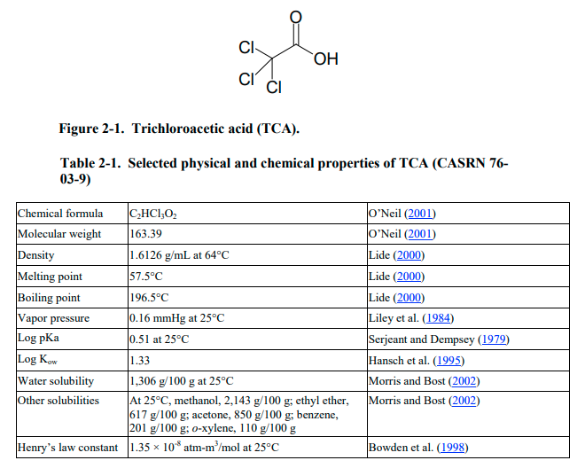
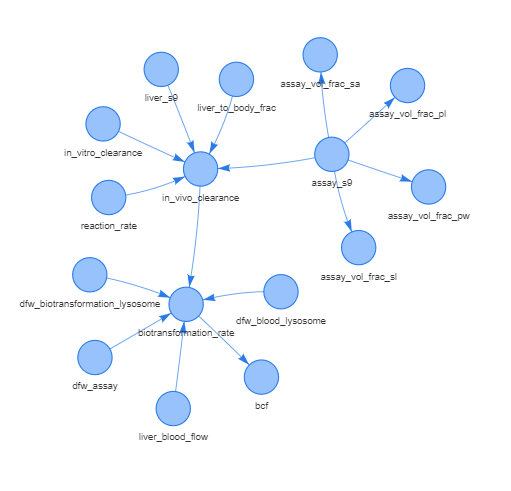
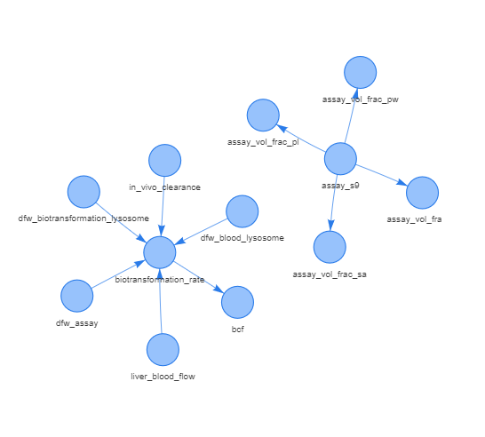

```{r, include = FALSE}
knitr::opts_chunk$set(
  collapse = TRUE,
  comment = "#>"
)
```

## Getting started

The aim of this guide is to provide a short form demonstration of the various utilities of this package. It is assumed that the user has some understanding of Bioconcentration factor (BCF) calculations and the BIONICv3 package has already been installed.

To check this, run:

```{r setup}
devtools::load_all()
library(BIONICv3)
```

For additional details on how to install please refer to the README.

## Simple BCF prediction

The following example will look at **Trichloroacetic Acid** and how it is possible to make BCF predictions using the BIONICv3 package.

```{r fig1, fig.cap="<i>Figure 1: Brief summary of Trichloroacetic acid [@epa-image] </i>", fig.align='center', echo=FALSE}

```

For the current configuration of the BIONIC v3 package, there are only 3 mandatory inputs. These are logP, pKa and ionisation type. So as our first run of the model, we will provide only these. The following information has been found for tricholoroacetic acid from the Pubchem website:

-   logKow : 1.33

-   pKa : 0.51

-   Ionisation type : Acid

Note that the input to the model is a data frame containing any number of desired inputs as column headers. More details on this to follow.

```{r example1}
mandatory_df <-as.data.frame(list("ion_type"="A", 
                               "pka"=0.51, 
                               "KOWN"=10^1.33,
                               "biota_mass" = 0.1,
                               "reaction_rate" = 0.5))
knitr::kable(mandatory_df)
```

From here, we pass this data frame to the `run_bionic_v3()` function. The output will be a list containing all of the parameters through the model. To make it easier to view, we filter to only show the various k rate parameters and the BCF as shown in this equation:

$$BCF = \frac{C_B}{C_W} = V_w + \frac{kU}{kW + kB + kF + kG}\tag{1}$$

```{r example2}
answer_list <- run_bionic_v3(mandatory_df)
answer_df <- as.data.frame(answer_list)
bcf <- answer_df[,c("gill_uptake_rate",
                     "gill_elimination_rate",
                     "biotransformation_rate",
                     "fecal_egestion_rate",
                     "growth_rate",
                     "bcf")]
knitr::kable(bcf)

```

We're able to run the model with such a small number of parameters since many of the values are defaulted using the original values provided in the Excel tool.

Therefore it is important to keep in mind that by not passing specific inputs, there are many assumptions being made in the background that may or may not be true for the specific test case.

## Specific BCF prediction

To dive in more deeply, `run_bionic_v3()` uses the `create_bionicv3_model()` function to create the preconfigured instance of the model. This can be a useful place to start if you want to get and understanding of the parameter space.

```{r example3}
base_model <- create_bionicv3_model()
```

The following object base_model is an igraph, to inspect the parameterisation of the model we can index either the edges or the verticies. 

```{r example31}
base_model$vertices$water_temp
```

Taking water temperature as an example, we can see that the default value is set to 25, meaning if another value is not given through the input data frame. There is in effect a hidden assumption stating 25C is an appropriate temperature for the chosen test system.

It is therefore recommended to consider in more detail what kind of environmental, species and test system assumptions should be made. Then these should be represented through the parameters provided.

So for the next prediction, we'll be taking the following into consideration: our species of interest is Zebrafish (Danio Rerio). [@brinkmann2016], provides some experimental data we can use as inputs to the model:

-   Average biota mass is 288mg (0.000288kg)

-   Lipid content is reported as 6.7%

-   Default parameterisation for storage lipid to phospholipid ratio is 3:1, therefore we split 6.7% the same way

-   Average temperature from the experiments is 24.5C

-   As we have no S9 assay data, we will also set the biotransformation value to 0

-   The mean dissolved oxygen concentration for one of the studies was 8.29

-   Finally, suppose that an experimentally derived logKmw value is available as 

-   As there is limited support for the anionic fraction parameter in the model, we've decided to edit it to see the impact on the prediction 0.175 -> -0.4

```{r example4}
custom <-list("ion_type"="A", 
              "pka"=0.51, 
              "KOWN"=10^1.33,
              "biota_mass"=0.000288,
              "mass_frac_sl"=0.05025,
              "mass_frac_pl"=0.01675,
              "water_temp"=24.5,
              "biotransformation_rate"=0,
              "oxygen_conc_water"=8.29,
              "KMWN"=10^2.9,
              "anionic_frac"=0.4)
```

Then just as before we pass this to the main run function to get our output:

```{r example5}
custom_ans_list <- run_bionic_v3(as.data.frame(custom))
custom_ans_df <- as.data.frame(custom_ans_list)
custom_bcf <- custom_ans_df[,c("gill_uptake_rate",
                     "gill_elimination_rate",
                     "biotransformation_rate",
                     "fecal_egestion_rate",
                     "growth_rate",
                     "bcf")]
knitr::kable(custom_bcf)

```

We can see there is change to most of the k rate parameters and therefore the BCF output value as well.

## Bulk BCF prediction

For bulk predictions, simply provide the starting data frame with as many rows as required. It is recommended to use the template file provided, this will include all parameter columns by default, but any left blank (or containing NA) will be ignored.

Edits can be made either through the use of Excel, by saving the template and adding the values to the relevant columns. 
```{r example6, eval=FALSE}
input_template <- BIONICv3::template_bionicv3
write.csv(input_template, "input_template.csv")
# Edit offline in Excel
filled_template <- read.csv("path_to_filled_template.csv")
run_bionic_v3(filled_template)

```

Or editing in R, by computationally generating the input parameters and populating either the blank template. There is also an example of a bulk table provided as part of the package 

```{r example61, eval=FALSE}
bulk_example <- BIONICv3::bulk_example_bionicv3
bulk_answer_list <- run_bionic_v3(bulk_example)
bulk_answer_df <- as.data.frame(bulk_answer_list)

bulk_bcf <- bulk_answer_df[,c("gill_uptake_rate",
                              "gill_elimination_rate",
                              "biotransformation_rate",
                              "fecal_egestion_rate",
                              "growth_rate",
                              "bcf")]
bulk_bcf

```

To get additional information about each parameter, please visit the long form vignette for all equations and parameters.

## Interrogating results

It is also possible to further interrogate the model by looking at various parameters:

-   What is the ionisable fraction

```{r example7}
# using the custom run of the model from before 
speciation <- custom_ans_df[,c("speciation_bio_ion")]
speciation

```

As the pKa value for this chemical is small, we would expect that the chemical is highly ionised at biologically relevant pH. 


-   Which part of the species composition contributes most to the sorption of the chemical eg. storage lipid, phosophlipid etc. ?

```{r example8}
sorption_cap <- custom_ans_df[,c("DSW", "DMW", "DPW", "DSAW", "DMWAN")]
sorption_cap

```

-   What values go into calculating the uptake rate?

This is made easier by first looking at the equation for the uptake rate:

$$kU = EW \cdot \frac{GV}{Mass}\tag{2}$$

-   $kU (L/kg/d)$ - uptake rate constant via gill ventilation

-   $EW (unitless)$ - chemical uptake efficiency at the gill

-   $GV (L/d)$ - ventilation rate

-   $Mass (kg)$ - the mass of the fish

Note for this, plus all other equation in the model, please refer to the comprehensive model guide vignette.

```{r example9}
# Change these to be the uptake parameters from the answer_df
uptake_params <- custom_ans_df[,c("biota_mass", "gill_vent_rate", "gill_uptake_efficiency", "gill_uptake_rate")]
uptake_params

```

## Graph operations / logic

This section provides some details around how the `run_bionic_v3()` function works, and some of the motivations behind it's design.

Firstly, the model has a particularly large number of input parameters. Where each parameter may be used in several equations to produce other intermediate values which eventually combine to produce a final BCF. Therefore we must be able to define each parameter of the model as one of the following:

1.  Assigned a value by input

2.  Use some default value hard coded in the model

3.  Calculated value using some pre-defined equation (using other parameters in the model)

To meet all three of these criteria, and to allow complete flexibility with what parameters can be inputted (overridden) some dynamic parameter space must be created.

Hence the choice to use a graph, where each node (vertex) is a parameter and each edge is a "calculation route".

Here's small snapshot of the BIONICv3 graph:

```{r graph1}

```

In this scenario we're trying to calculate biotransformation_rate (note not all nodes/edges are shown to calculate it).

One of the values required is in_vivo_clearance, which itself can be calculated using the following equation:

$$\begin{aligned}CLint_{invivo} = 24 * CLint_{invitro} * LiverS9 * LiverBWF \end{aligned} \tag{3}$$ Now suppose we have a value for this, which we've calculated separately from this model and want to include it, overriding the current calculation path. Here's how the graph will be impacted.

```{r graph2}

```

All 0 degree (with no outgoing edges) nodes are pruned from the graph. Unused calculation edges are also removed.

Finally, the calculations happen according to a topological order sort so that the input to each calculation is calculated before the calculation happens. (Note that this requires the graph to be directed and acyclic)

So in our graph, the assay_vol_frac calculations likely happen separately but they still use the assay_s9 value which wasn't pruned since it's used elsewhere. Then the calculation to get the biotransformation_rate using the 5 incoming nodes (including the user input in_vivo_clearance). Then finally the bcf calculation, which here doesn't include the other incoming nodes for simplicity.

## Full graph

It may also be helpful to view the full BIONIC model graph, with all nodes and edges shown. (Ensure that the vignette is being viewed as as HTML) We can even select individual nodes, or select nodes from the drop down to view first and second degree connected nodes.

```{r echo=FALSE, results='asis'}
htmltools::tags$iframe(
  src = "figures/bionic_graph.html",
  width = "100%",
  height = "600px",
  frameBorder = "0"
)
```

## References
